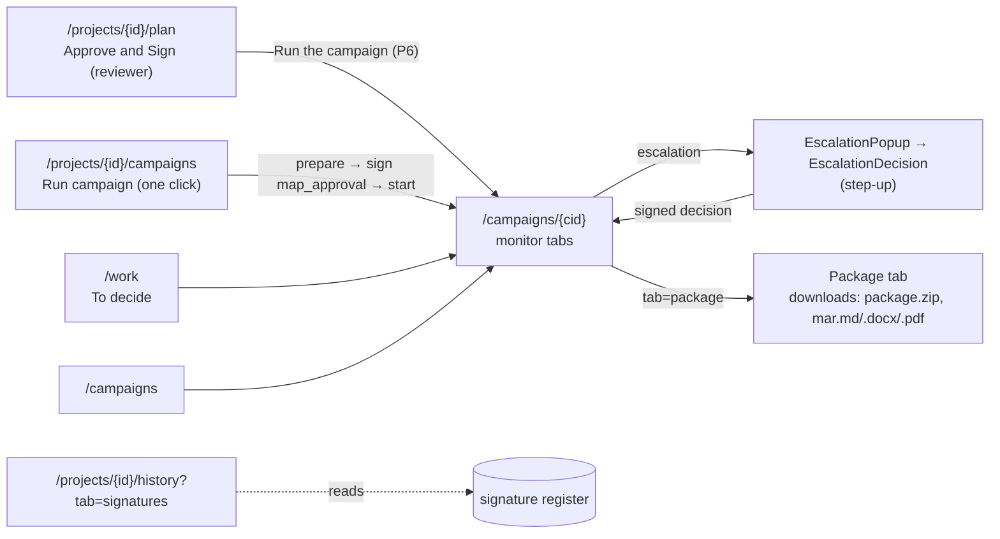

# 03 · Application sitemap (post-MAP scope)

Scope: the screens a person uses from a signed MAP to a downloaded submission package. Pre-MAP pages (Start, Inputs,
Data room, intake) appear only as entry points. Source: `apps/web` (Next.js 16, App Router). All facts below were read
in code; nothing was run in a browser for this report.

## 1. Map

```text
Shell (app/layout.tsx)
├─ SideNav (components/shell/SideNav.tsx)                    "Campaigns" link at :62
├─ EscalationPopup overlay (components/campaign/EscalationPopup.tsx)   polls GET /api/v1/escalations every 5 s
├─ StepUpDialog overlay (components/StepUpDialog.tsx)        opens Keycloak loa2 in a pop-up on 403 STEP_UP_*
│
├─ /                         Home: portfolio, running-campaign count          components/portfolio/Home.tsx
├─ /work                     Your work: "To decide" escalations, step items    app/work/page.tsx; lib/portfolio.ts
├─ /review                   → redirect to /work (review inbox retired 2026-11-11)   app/review/page.tsx
├─ /campaigns                Campaigns list (all of the person's projects)      app/campaigns/page.tsx
│                             components/portfolio/Campaigns.tsx
├─ /campaigns/{campaignId}?tab=…   Campaign monitor                           app/campaigns/[campaignId]/page.tsx
│   ├─ stages (default)      stage table, stage notes, time-budget meter
│   ├─ fit                   goodness-of-fit chart (kit chart)
│   ├─ rounds                round history, change ledger, influence map     components/campaign/History.tsx
│   ├─ feedback              S5 diagnosis, cycle timeline, "Open the decision"   components/campaign/Feedback.tsx,
│   │                                                                              OpenDecisionButton.tsx
│   ├─ prediction            (only when S6 produced one) sensitivity, intervals, VBE card   components/campaign/Vbe.tsx
│   └─ package               S7 reproduction, hashes, PK-Sim projects, report issues, downloads
│                             components/PackageDownloads.tsx
├─ /projects/{id}            Overview: latest campaign, work items             app/projects/[projectId]/page.tsx
│   ├─ /plan                 Step 3 "Review & sign": Approve and Sign; Run the campaign (P6)
│   │                         components/plan/PlanCanvas.tsx
│   ├─ /campaigns            Step 4 "Run": what is missing, one-click Run campaign, studies, campaigns
│   │                         app/projects/[projectId]/campaigns/page.tsx; components/RunCampaignButton.tsx
│   └─ /history?tab=signatures   Signature register (escalation decisions included)
│                             app/projects/[projectId]/history/page.tsx
└─ /admin/system             Engine status (kind, reachable, digest), execution backend   app/admin/system/page.tsx
```

## 2. Navigation flow



## 3. Page by page

### `/campaigns` - Campaigns list
- **Reads:** `GET /api/v1/campaigns`, `GET /api/v1/projects` (server component).
- **Shows:** id, project, compound, status, current stage, share of budget used; a status filter.
- **Empty state:** "No campaign has run yet…".
- **Gap:** no fixture-engine or test-only flag in the list; the comment defers to the campaign page
  (`components/portfolio/Campaigns.tsx:4-5`).

### `/campaigns/{campaignId}` - Campaign monitor
- **Reads:** `GET /api/v1/campaigns/{id}`; on the package tab also `GET /api/v1/campaigns/{id}/package`
  (`app/campaigns/[campaignId]/page.tsx:88`).
- **Header:** compound, question, status, risk badge; facts line with an acceptance limit **hard-coded** in the page
  (high 1.25, low 2, else 1.5; `page.tsx:73`), the internal target, current stage, engine line when PK-Sim.
- **Banners:**
  - red "Not a PBPK result" when `engine.kind !== "pksim"` (`page.tsx:106-114`); none when `engine` is null;
  - "TEST ONLY" when a stage's real-data summary is judged and not passable (`page.tsx:115-121`);
  - no banner for a pilot/development deployment although `deployment` is stored on the record.
- **Live updates:** `AutoRefresh` calls `router.refresh()` every 2.5 s while QUEUED or RUNNING
  (`components/AutoRefresh.tsx:8-15`). It stops at ESCALATED or AWAITING_SIGNATURE.
- **Not found:** "not recorded yet" banner and polling (`page.tsx:53-68`).
- **Package tab:** reproduced yes/no, released yes/no, package and data-bundle sha256 (first 16 chars), file count,
  PK-Sim projects and their notes, report issues and notes; one download button per artifact the API lists
  (`page.tsx:294-344`). Downloads fetch with the bearer and save a blob (`PackageDownloads.tsx:23-38`).
- **Absent by design:** a raw "Runs" tab (waits for multi-server, R-N08; `page.tsx:22-23`).

### `/projects/{id}/plan` - Review & sign (entry point)
- **Approve and Sign** → `POST /projects/{id}/plan:sign` (reviewer only, step-up). Enabled for curators and reviewers
  in the UI (`PlanCanvas.tsx:224, 236, 312`); a curator gets 403.
- **Run the campaign (P6)** appears once signed with no pending deviations; posts `view.map.campaign` to
  `POST /projects/{id}/campaigns` with no busy/disabled state (`PlanCanvas.tsx:373-380`).

### `/projects/{id}/campaigns` - Run
- `runnable` needs a question, a compound and at least one uploaded study (`campaigns/page.tsx:40-47`).
- **Run campaign** (one click): `campaign:prepare` → `POST /projects/{id}/signatures` (`map_approval`) → start; shows
  "Generating the MAP… / Signing the MAP… / Starting…" and navigates to the monitor (`RunCampaignButton.tsx:28-64`).

### Escalation pop-up and decision form
- Mounted once in the shell (`app/layout.tsx:88`); shows a flash bar on the campaign's page or its project's pages for
  escalations with `can_decide`.
- Form (`components/EscalationDecision.tsx`): reason in words, evidence, S5 diagnosis table, a select of the stored
  options (disabled options explained), learn checkboxes and beyond-cap reason, new-evidence fields, optional rationale;
  "Sign & submit" → confirm dialog → `POST …/escalation:resolve`. On 403 STEP_UP_* the StepUpDialog opens Keycloak loa2
  in a pop-up and retries once (`lib/api.ts:126-138`; `StepUpDialog.tsx`).

### `/admin/system`
- Engine kind (a fixture shown in bold as "not PK-Sim"), command, engine id, digest, execution backend; the engine check
  starts the engine command with no job (up to 20 s, cached 60 s; `services/api/src/modeler_api/engine_check.py`).

## 4. Interaction states worth knowing

| State | What the person sees | Source |
|---|---|---|
| Campaign QUEUED/RUNNING | stage table fills in, page refreshes every 2.5 s | `AutoRefresh.tsx` |
| ESCALATED | flash bar, decision dialog; polling of the page stops | `EscalationPopup.tsx`; `page.tsx:122` |
| AWAITING_SIGNATURE (before S6) | decision with options approve / abort | `local_runner.py:105-109` |
| S5 failed | feedback tab with diagnosis; options limitation / learn / new evidence / stop | `Feedback.tsx`; `orchestrator/feedback.py:120-136` |
| S7 not reproducible | package tab shows "not released" and the failures; zip download answers 409 | `read_api.py:215-234` |
| API restarted mid-run | campaign stays RUNNING; no recovery or cancel (see 12_GAPS) | `services/api/src/modeler_api/main.py:44-56` |
