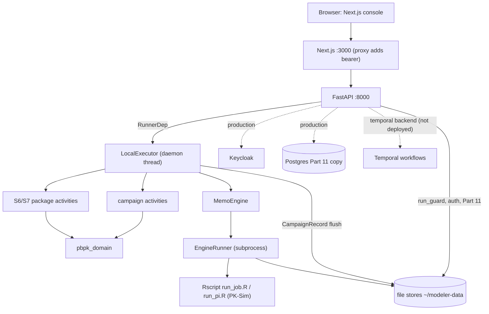

# 04 · System architecture (post-MAP scope)

Diagram source: `architecture.mmd` (also embedded below). Deployment facts come from `deploy/server/*` and
`deploy/dev/*`; whether the server currently runs pilot or production cannot be told from the repository.

## 1. Layers

The repository enforces an import order (`docs/ARCHITECTURE_BOUNDARIES.md`, `tests/architecture/boundaries.toml`,
checked in `make test` and CI; zero recorded exceptions today).

| Layer | Package | Post-MAP responsibility |
|---|---|---|
| L0 | `pbpk_domain` (`packages/pbpk-domain`) | Pure science and documents: CPF, MAP, split, round build, snapshot builder, NCA, acceptance, diagnostics, fit spec, multistart, identifiability, VPC, S6 prediction, VBE, model systems, MAR, reproducibility, M15, validation pack, rulesets |
| L1 | `modeler_contracts` (`packages/run-contracts`) | Dataclass contracts (`EngineJob`, `EngineManifest`, `CampaignRequest`, `RoundContext`, `FitRoundRequest`…), the engine port (`ports.engine_factory`), runtime configuration (`runtime.py`) |
| L2 | `modeler_intake` | (pre-MAP) |
| L3 | `modeler_project` | Plan → MAP, fit bounds, members, audit file chain (`audit.py`) |
| L3 | `modeler_storage` | File read/write stores (`filestore.py`), records (`records.py`), jobs/leases, Postgres audit/Part 11 (`audit.py`, `part11.py`, `db/*`), S3 object store |
| L4 | `modeler_agents` | Strategist (`strategist.py`; deterministic in the campaign) |
| L5 | `modeler_orchestrator` (`services/orchestrator`) | Campaign execution: `LocalExecutor`, Temporal workflows, activities, memo, ledger, feedback, SJ, S6/S7 activities |
| L5 | `modeler_engine` (`services/engine-worker`) | Subprocess runner, Temporal engine worker, presigned object store; R scripts and golden tests |
| L6 | `modeler_api` (`services/api`) | HTTP routes, auth, run guard, signatures, Part 11 recording, read models |
| L7 | `apps/web` | Next.js console |

Seams: the API reaches the orchestrator only through `modeler_api.execution` (`RunnerDep` → `LocalCampaignRunner`), and
the orchestrator reaches the engine only through the `modeler.engines` entry point (`modeler_contracts.ports`).

## 2. Component diagram

## 3. Components and their responsibilities

| Component | Responsibility | Talks to | Source |
|---|---|---|---|
| Web console | Monitor, decisions with step-up, package downloads | API through the Next proxy (bearer) | `apps/web/app/campaigns/[campaignId]/page.tsx`, `components/EscalationDecision.tsx`, `lib/api.ts` |
| API | Start campaigns, decide escalations, serve monitor and package, sign | orchestrator seam, file stores, Keycloak JWKS, Postgres | `services/api/src/modeler_api/*` |
| Run guard | Refuse starts on unsigned MAPs, overridden limits, CPF ≠ MAP (pilot/production only) | file stores, audit chain | `run_guard.py` |
| LocalExecutor | Stage machine, round loop, gates, escalations, S6 gate, feedback, SJ, no-regression, S6, S7 | activities, engine, file stores | `local_runner.py` |
| Campaign activities | Plan stage, build snapshot, prepare engine job, apply fit, evaluate, diagnose, choose, VPC | `pbpk_domain`, strategist | `campaign_activities.py` |
| Fitting activities | Multistart jobs, read `pi_result.json`, assess starts | engine, `pbpk_domain.fitting` | `fitting_activities.py` |
| Package activities | S6 sensitivity/batch jobs and reduction; S7 evidence, bundle, re-run, `.pksim5`, MAR, zip | engine, `pbpk_domain.report`, `reproducibility` | `package_activities.py` |
| MemoEngine | Reuse identical successful engine jobs (S7 re-runs exempt) | engine, memo records under `<read_root>/<tenant>/memo` | `memo.py` |
| EngineRunner | Stage inputs with sha256 checks, run the command, enforce timeout, hash outputs, build manifest | `run_job.R` | `services/engine-worker/src/modeler_engine/runner.py` |
| run_job.R | Eight tasks: simulate, dry_run, convert_to_project, pk_analysis, population, sensitivity, batch, parameter_identification | ospsuite / PK-Sim | `services/engine-worker/r/run_job.R` |
| run_pi.R | One PI start: datasets, weights, base units, log scale, fit groups, Hessian CI, correlations | `ospsuite.parameteridentification` 2.2.0 | `services/engine-worker/r/run_pi.R` |
| File stores | `campaigns.json`, `escalations.json` per tenant, audit chain, CPF/MAP/prep files, object store | - | `packages/storage/src/modeler_storage/filestore.py` |
| Keycloak | OIDC sign-in, loa2 step-up (password + TOTP) | API (JWKS), web (PKCE) | `deploy/keycloak/realm-modeler.json`, `deploy/server/keycloak.sh` |
| PostgreSQL | Production copy of every audit event and signature row (append-only) | API | `services/api/migrations/*.sql`, `modeler_storage/part11.py` |
| Renderers | DOCX via pandoc, PDF/A-2b via typst (LaTeX fallback) | - | `pbpk_domain/report/render.py` |

## 4. Communication

| From → to | Mechanism | Format | Notes |
|---|---|---|---|
| Browser → web → API | HTTPS/HTTP, `/api/*` proxied with the person's access token | JSON envelope `{data, meta, errors}` | polling, no SSE or WebSocket |
| API → orchestrator | in-process call; work continues on a daemon thread | Python dataclasses | no queue, no lease, no recovery |
| Orchestrator → engine | `subprocess.Popen([*command, job.json])`, own process group | `job.json` in, files + `engine_manifest.json` out; stdout `PROGRESS`/`WARNING` lines | env allow-list; one OS process per job |
| Orchestrator → stores | atomic file writes under `file_lock` | JSON documents | the whole `campaigns.json` rewritten per flush |
| API → Part 11 | append to `audit.jsonl` (hash chain); in production first insert into Postgres | JSON lines / rows | signatures only, not campaign events |
| API → Temporal (unused) | `Client.start_workflow` and signals | Temporal payloads | decision routes answer 503 |

## 5. Deployment: intended vs actual

| Concern | Intended (ENGINEERING_PLAN §1, §8–9, "FINALIZED") | Actual (deploy scripts) |
|---|---|---|
| Orchestration | Temporal cluster with orchestrator and engine workers on queues engine-s/m/l | `LocalExecutor` in the API process; no worker started |
| Storage | CloudNativePG + MinIO with Object Lock | files under `~/modeler-data` (not backed up); Postgres only for Keycloak and the Part 11 copy |
| Runtime | k3s on 3 servers, KEDA, Argo CD, Prometheus/Loki/Tempo | one server, cron `@reboot` + 5-min watchdog, no Helm/k8s files in the repo |
| Engine | digest-pinned, cosign-signed image from GHCR | conda R install in `~/modeler-engine`; "digest" = hash of `golden/catalog.json` |
| Auth | Keycloak OIDC with step-up | Keycloak when `MODELER_OIDC_ISSUER` is set (production); otherwise pilot with the DEV verifier on `0.0.0.0:8000` |
| Live updates | SSE `/campaigns/{id}/events` | polling |

Ports: web 3000, API 8000 (both `0.0.0.0`), Keycloak 8443/8080, Postgres 5432 (127.0.0.1). Data: `~/modeler-data`
(read root + object store), `~/modeler-logs`, `~/modeler-engine`, `~/.modeler-secrets.env` (chmod 600). Deploy:
`deploy/dev/deploy_to_server.sh` rsyncs from the Mac, rebuilds, and restarts the stack (which kills running campaigns).

## 6. External dependencies (post-MAP, actively used)

| Dependency | Used for | Pinning |
|---|---|---|
| ospsuite R 12.4.4, PK-Sim 12.3.173, .NET 8 | simulation | image pins by commit + hash; server installer pulls the newest from r-universe |
| ospsuite.parameteridentification 2.2.0 | PI (private internals overridden in `run_pi.R`) | image: commit + tree hash; server: newest |
| rSharp 1.2.2 | .NET bridge | tag tarball, no hash |
| Temporal Python SDK | `activity.logger` and the unused workflows | `uv.lock` |
| pypandoc-binary 1.17, typst 0.15.0 | MAR rendering | `uv.lock` |
| numpy, scipy, pydantic, FastAPI, PyJWT, asyncpg, SQLAlchemy | domain math, API, auth, Postgres | `uv.lock` |
| Keycloak 26.7.5, PostgreSQL 16 | identity, Part 11 copy | install scripts |
| LLM providers (LiteLLM/Ollama, Anthropic, Groq, NVIDIA) | pre-MAP agents; the post-MAP strategist is not wired to one | config |

## 7. Architectural observations

- The **deployed architecture is a monolith with an in-process background thread**, while the documentation describes
  a distributed, durable system. The gap matters for Part 11 (durability, audit of events) and for the one-hour goal
  (no cross-campaign CPU scheduling).
- The **science is single-sourced** between the two execution paths (both call the same activities), but loop control
  is duplicated and has drifted (budgets, retries, deadlines, error tolerance; see `11` §4).
- **Integrity is strong at the engine boundary** (sha256 per input, re-checked in R) and **weak at the API boundary**
  (client-supplied `file://` URIs, self-declared MAP status, unverified CPF hash).
