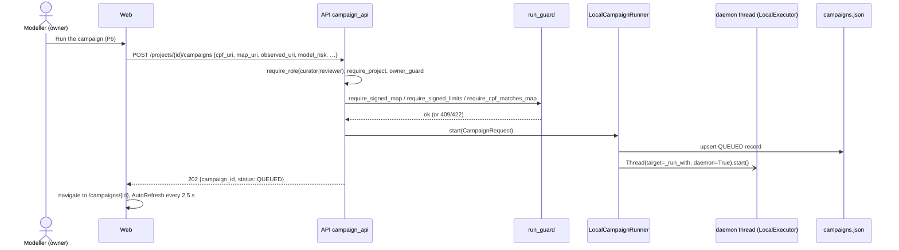
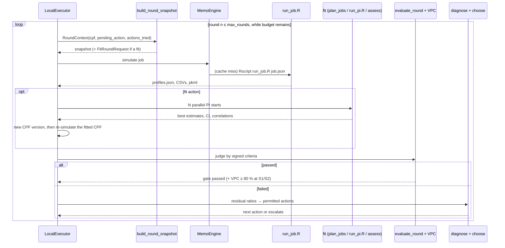
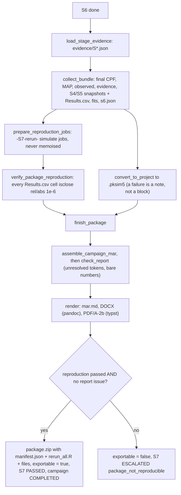

# 06 · Workflow analysis (post-MAP scope)

The stage machine is in `workflows.mmd`. Each workflow below gives the starting point, steps, data, rules, output,
and failure paths. Paths are relative to the repository root; `LR` = `services/orchestrator/src/modeler_orchestrator/
local_runner.py`, `CA` = `…/campaign_activities.py`, `PA` = `…/package_activities.py`.

---

## W1 · Start a campaign after the MAP is signed

**Start:** `/projects/{id}/plan` ("Run the campaign (P6)") or `/projects/{id}/campaigns` ("Run campaign").

| Step | What happens | Where |
|---|---|---|
| 1 | Plan path: `plan:sign` (reviewer, step-up) generated, signed and staged the CPF, MAP and observed PK under `prep/plan-v{n}`; the page holds `map.campaign` (the start body with server `file://` URIs) | `plan_api.py:518-601` |
| 1′ | One-click path: `campaign:prepare` stages the same under `prep/{question_id}` (overwritten on each prepare), then `POST /signatures` (`map_approval`), then the start | `write_api.py:182-293`; `RunCampaignButton.tsx:28-64` |
| 2 | `POST /api/v1/projects/{id}/campaigns` with `CampaignStartRequest` (compound, map_id, cpf_uri, cpf_sha256, map_uri, observed_uri, system_uri, question, model_risk, stages) | `campaign_api.py:29-44` |
| 3 | Role curator/reviewer, project member, owner (`owner_guard`) | `campaign_api.py:26,49`; `ownership.py` |
| 4 | Run guard, skipped in development: signed MAP (409), no stage-budget override (422), CPF equals the MAP's parameter table (409, D-36) | `run_guard.py:68-105` |
| 5 | `CampaignRequest` built (`camp_<uuid>`, default stages S0…S7, `max_rounds_per_stage` 4, seed 1); `map_sha256`/`observed_sha256` left empty | `campaign_api.py:55-62`; `runs.py:200-221` |
| 6 | Local backend: write the QUEUED monitor record, start a daemon thread, answer 202 `{campaign_id, status: QUEUED, status_url}` | `LR:1153-1169`; `campaign_api.py:75-81` |

**Failure paths:** 409/422 from the guard; 503 without `MODELER_READ_ROOT`; with the Temporal backend, the workflow then
waits for a `map_signed` signal no code sends (`campaign.py:342-349`). A double click on "Run the campaign (P6)" starts
two campaigns (no idempotency key, no busy state).

---

## W2 · Training stage round loop (S1 IV, S2 oral fasted, S3 formulation/fed, SM metabolites)

**Inputs:** the current CPF version, the signed MAP (scenarios, stage plan, acceptance), observed PK per study, the
model system (if any), seed.

| Step | What happens | Where |
|---|---|---|
| 1 | Limits: budget = start override > signed MAP stage plan > 1800 s; rounds = MAP > 4; the source is written as a stage note | `LR:593-612` |
| 2 | `plan_stage`: absent (SM not planned), skipped with reason, or fit | `CA:165-194` |
| 3 | `build_round_snapshot`: scenarios for the stage → builder specs → PK-Sim snapshot written to `…/snapshots/<campaign>-<stage>-r<n>.json`; sha256 of the exact bytes; on a fit action also the PI spec and `FitRoundRequest` | `CA:426-498`, `:296-409`; `pbpk_domain/campaign/round_build.py` |
| 4 | `prepare_round_job` → engine `simulate` (with `export_pkml` on a fit or VPC stage) | `CA:501-519` |
| 5 | Fit round: pkml outputs become the fit's model inputs; `plan_jobs` sizes the multistart (4–32 Latin-hypercube starts within budget − reserve); starts run in parallel subprocesses; `assess_round` picks the best converged start and flags bounds, correlations, agreement, missing CI | `CA:412-423`; `fitting_activities.py:27-158`; `LR:1050-1069` |
| 6 | `run_round`: the best start's estimates are written into a new CPF version (status FITTED, provenance ParameterIdentification, SD/CV/CI) | `CA:619-697`; `pbpk_domain/fit_spec.py:280-306` |
| 7 | If the CPF changed, re-simulate the fitted CPF ("postfit") and judge that | `LR:1011-1024` |
| 8 | `evaluate_round`: profiles read at the observed sampling times, NCA, fold-error verdicts by the **signed** criteria and internal target, grouped by role/analyte/group/quantity | `CA:700-797`; `pbpk_domain/campaign/evaluate.py` |
| 9 | Gate passed at S1/S2 → VPC: one population job per study (100 individuals), coverage of observed points by the 5–95 % band must be ≥ 80 % | `CA:528-602` |
| 10 | Gate failed → `diagnose_round`: residual ratios per study → ruleset → permitted actions (fittable candidates only), multi-compound merge, fix_and_refit pairs decided from signed grades | `CA:939-1051` |
| 11 | `choose_action`: first untried permitted action (no LLM decider wired) | `CA:1054-1073` |
| 12 | Loop until pass, escalation, rounds or budget exhausted | `LR:614-677` |

**Outputs:** a passed stage carries the new CPF forward; each round is a monitor row (verdict, GMFE, studies, groups,
VPC, findings, real-data summary, model set); a ledger entry per CPF change; stage evidence persisted for S7.

**Failure paths:** `budget_exhausted` (checked only at round start or when the multistart cannot fit), `rounds_exhausted`,
`no_permitted_action`, `vpc_coverage_below_80`, `stage_failed` (any exception, including **one failed PI start**). A
`branch`/`switch`/`switch_algorithm` action re-simulates the unchanged CPF and consumes a round.

---

## W3 · No-regression gate and SJ joint refinement

| Step | What happens | Where |
|---|---|---|
| 1 | After a training stage passes with a changed CPF, every earlier passed training stage is re-judged on it (judge only) | `LR:531-548, 834-858` |
| 2 | A regression triggers one joint fit over the stages up to this one; if it fails, the stage escalates `regression` | `LR:536-548` |
| 3 | SJ stage: parameters FITTED at S1–S3/SM with a fit policy; S1-fitted ones bounded by their S1 95 % CI; a derived MAP `map-SJ-<tag>.json`; baseline round, then joint fit with equal study weights √(N/(k·n)) | `LR:878-942`; `orchestrator/joint.py` |
| 4 | Keep the joint estimate only if fitted, every study passes, and mean(AUC GMFE, Cmax GMFE) is not worse | `LR:908-939` |

---

## W4 · Escalation decision with a Part 11 signature

**Start:** the escalation pop-up (flash bar) on the campaign or project page, or "Your work".

| Step | What happens | Where |
|---|---|---|
| 1 | Monitor stops at ESCALATED / AWAITING_SIGNATURE / FEEDBACK_PENDING; escalation row written with reason code, evidence and options | `LR:395-423, 560-582` |
| 2 | The person chooses an option and an optional rationale → `POST /campaigns/{cid}/stages/{st}/escalation:resolve` | `components/EscalationDecision.tsx` |
| 3 | API: local backend only; campaign found; project member; `ensure_owner(signing=True)`; escalation still open (409) | `escalations.py:219-246` |
| 4 | `approve` only: D-19 real-data refusal; feedback actions: guardrails (spent studies, cycle cap, evidence unit/source/plausibility) | `escalations.py:246-257`; `LR:1178-1218` |
| 5 | Step-up check (403 STEP_UP_REQUIRED → Keycloak loa2 pop-up → retry once) | `auth.py:163-169`; `StepUpDialog.tsx` |
| 6 | Signature: meaning Approved, record `<cid>-<stage>`, hash of `cid:stage:action` (or of the decision payload) → audit chain (+ Postgres in production) | `escalations.py:258-270`; `part11.py` |
| 7 | `resolve_escalation`: claim by removing the escalation (a second decision is refused); apply abort / accept_best / retry / approve / learn / new_evidence; continue remaining stages on a new daemon thread | `LR:1220-1318` |

**Rules not enforced:** the action is not checked against the escalation's options (an `accept_best` at the S6 gate is
accepted and skips S6); the signer may be the person who started the campaign; the signature is recorded before the
claim, so a lost race leaves a signature for a decision that was not applied.

---

## W5 · S4 internal and S5 external validation, and the S5 feedback cycle

| Step | What happens | Where |
|---|---|---|
| 1 | Simulate the final CPF once (judge only); unbuildable validation studies are named "NOT SIMULATED" instead of failing | `LR:679-708`; `CA:460-465` |
| 2 | S5 groups by food state (fasted and fed judged separately); external core classes only | `CA:726-729`; `campaign/map.py:509-510` |
| 3 | S4 failure → escalation (limitation and continue, or stop) | `LR:100-103` |
| 4 | S5 failure → `_diagnose_s5`: per failing study the metric, direction, class, the stage it would train, documented differences from training, influential parameters (engine sensitivity), per-class learn possibility and cap, MS-01 §6.6 path, a recommendation | `LR:944-975`; `feedback.py:94-158` |
| 5 | Decisions: **limitation** (context of use restricted, signed note); **learn** (studies move to internal, MAP revised and signed by the decision, cycle c+1 re-runs [S(k), SJ, S4, S5]); **new evidence** (one parameter replaced by a measured value in the CPF's unit, FIXED, cycle c+1 from S1, flagged "prompted by S5"); **stop** | `LR:1277-1361`; `feedback.py:189-277` |

---

## W6 · S6 signature gate, prediction and VBE

| Step | What happens | Where |
|---|---|---|
| 1 | Before S6 the campaign pauses with `SIGNATURE_REQUIRED` (options approve / abort); status AWAITING_SIGNATURE | `LR:476-487` |
| 2 | `approve` (signed) passes `gate_refusal` (D-19: verdicts before the gate must rest on real data, unless the project is exploratory) | `LR:1178-1182, 1253-1254` |
| 3 | S6 re-simulates S4's scenarios from the final CPF with pkml export | `LR:732-765`; `CA:463` |
| 4 | Sensitivity: engine `sensitivity` task on FITTED/PREDICTED parameters, ±10 %, AUC and Cmax | `PA:105-118`; `campaign/prediction.py` |
| 5 | Uncertainty: 200 independent draws of fitted parameters (log-normal for log-scaled), engine `batch`, P5/P50/P95 of AUC and Cmax | `PA:204-240`; `prediction.py:54-118` |
| 6 | VBE (if the MAP pins `vbe-crossover`): TEST and reference arms from CPF formulations on a design scenario; K·n individuals created on the TEST arm and reused on the reference arm with seeded occasions; per-trial 90 % CI of the GMR; PoS per metric and joint; F-304 gate (NOT_VALIDATED without an observed BE study) | `orchestrator/vbe_activities.py`; `pbpk_domain/vbe.py` |

---

## W7 · S7 report and package

Sources: `LR:783-832`; `PA:252-428`; `pbpk_domain/reproducibility.py`; `pbpk_domain/report/*`.

**Gaps on this path:** stages accepted after escalation have no evidence file and are reported "not run"; fits from
feedback cycle ≥ 2 are not found by the bundle glob; S6 numbers are not re-run; the zip bytes vary per build and the
manifest covers neither itself nor `rerun_all.R`; `rerun_all.R` is never executed; nothing is signed; a VBE that did not
run puts a bare number ("0.2") in the MAR and withholds the package.

---

## W8 · Download the package

`GET /api/v1/campaigns/{cid}/package` (summary) and `GET …/package/{artifact}` (`package.zip`, `mar.md`, `mar.docx`,
`mar.pdf`). Reader role and project membership; the zip answers 409 unless exportable; the path must resolve under the
`file://` object-store root; no integrity re-check and no audit event (`read_api.py:160-234`).

---

## W9 · Failure and recovery behaviour

| Event | Behaviour | Source |
|---|---|---|
| Engine exits non-zero / times out | `EngineFailedError` / `EngineTimeoutError` with a 4,000-char stderr tail; local: the stage FAILS; outputs discarded | `runner.py:129-137`; `LR:524-530` |
| One PI start fails | the thread pool re-raises → stage FAILED (Temporal tolerates it) | `LR:1060-1069` |
| Study dropped by the engine (missing CSV/column) | only a `WARNING`; the gate judges the remaining studies | `run_job.R:87-111` |
| Exception outside the stage `try` (S0, `_no_regression`, `_influence`, flush) | the daemon thread dies; the campaign stays RUNNING | `LR:513-553` |
| API restart / deploy / watchdog | running campaigns lost; no reconciliation at startup; engine subprocesses may outlive the API | `services/api/src/modeler_api/main.py:44-56`; `runner.py:179` |
| Stage evidence write fails | swallowed (`OSError`); S7 reports the gap | `LR:715-730` |
| Two decisions on one escalation | the second is refused (the claim is the removal under lock) | `LR:1259-1262` |
| No cancel needed / wanted | no route exists; only `abort` at an open escalation | - |
