# System Intelligence Report: Modeler One, post-MAP scope

**Scope:** from a signed Model Analysis Plan (MAP) to the drawn submission package: the modelling campaign on PK-Sim
(MS-01 stages S1→S7), its human decisions, and the S7 report and package. Pre-MAP work (intake, Data room, literature,
brief, plan canvas) appears only where the campaign consumes it.
**Commit:** `1dbda7f` (2026-11-25). **Mode:** source-code investigation (Mode A); no running instance, no server, no
PK-Sim available. Python tests and ruff were run in the container.
**Labels:** VERIFIED (read in code or executed) · INFERRED (reasoned) · CONFIRMED / POTENTIAL (defects) · **(L)** =
re-verified line by line by the lead investigator.

## How to navigate

| If you want… | Read |
|---|---|
| the two-page answer | `00_EXECUTIVE_SUMMARY.md` |
| what the product does and for whom | `01_PRODUCT_OVERVIEW.md` |
| every feature with inputs, rules, errors, status | `02_FEATURE_CATALOG.md` · `FEATURE_INVENTORY.csv` |
| the screens and how to move between them | `03_APPLICATION_SITEMAP.md` |
| components, layers, deployment (intended vs actual) | `04_SYSTEM_ARCHITECTURE.md` · `architecture.mmd` |
| the code: structure, entry points, execution path, config | `05_CODEBASE_ANALYSIS.md` · `MODULE_INVENTORY.csv` |
| step-by-step workflows with sequence diagrams | `06_WORKFLOW_ANALYSIS.md` · `workflows.mmd` |
| endpoints, engine job contract, integrations | `07_API_INTEGRATION_CATALOG.md` · `API_INVENTORY.csv` |
| records, files, tables, transformations | `08_DATA_ARCHITECTURE.md` · `data_flow.mmd` |
| the science: acceptance, NCA, VPC, diagnostics, fitting, S6, VBE | `09_BUSINESS_LOGIC.md` |
| who may do what, and what gets signed | `10_ROLES_PERMISSIONS.md` |
| defect register with severity and evidence | `11_TECHNICAL_ASSESSMENT.md` |
| what is missing, hidden, or worth building next | `12_GAPS_AND_OPPORTUNITIES.md` |
| terms | `13_GLOSSARY.md` |
| the raw evidence notes with file:line citations | `evidence/` (start at `evidence/README.md`) |

Diagrams are Mermaid; the `.mmd` files render with `mmdc` or any Mermaid viewer, and the same diagrams are embedded in
the Markdown reports.

## Answers to the fifteen questions

1. **What exactly is this software?** A PBPK model-development platform that drives the OSP engine (ospsuite 12.4.4 /
   PK-Sim 12.3) to build, fit, validate and document a model under a signed plan, aiming at an ICH M15 / Part 11
   reviewable package. Post-MAP, it is a stage machine (S0–S7) executed in the API process (`01`, `04`).
2. **How is it designed?** As layered packages (L0 pure science → L7 web) with one engine port and one orchestrator
   seam, enforced by architecture tests; the CPF is the system of record and the signed MAP binds the run (`04` §1).
3. **How is it structured?** A uv workspace of five packages and four services plus a Next.js app; the post-MAP core is
   `pbpk_domain` (science), `modeler_orchestrator` (execution), `modeler_engine` + R scripts (engine), `modeler_api`
   (HTTP and Part 11) and the campaign pages (`05` §1).
4. **How does it work internally?** For each stage: plan from the MAP → regenerate a snapshot from the CPF → run PK-Sim
   in a subprocess → (fit with a multistart, write a new CPF version, re-simulate) → judge by the signed criteria →
   diagnose with a ruleset → pick the first permitted action → repeat or escalate for a signed decision; then validate,
   predict, bundle, re-run and report (`06`, `09`).
5. **What can it do?** Run S0→S7 on PK-Sim for single compounds and model systems; fit, validate fasted and fed,
   handle external failures through signed feedback cycles; sensitivity, uncertainty and virtual bioequivalence; MAR in
   MD/DOCX/PDF-A and a reproducibility-gated zip (`01` §7, `02`).
6. **What does each feature actually do?** See the 45 cards in `02_FEATURE_CATALOG.md`; notably three diagnostic
   action types do nothing (S-02), the strategist is deterministic, and "accept best" accepts the latest round (S-01).
7. **How do the components communicate?** Browser → Next proxy → FastAPI (JSON envelopes, polling); API → orchestrator
   in-process on daemon threads; orchestrator → engine by subprocess with `job.json` and sha256-checked files; state in
   JSON files; signatures on a hash chain, mirrored to Postgres in production (`04` §4).
8. **How does data move?** Staged CPF/MAP/observed → snapshots → engine outputs → verdicts in `campaigns.json` and
   stage evidence → new CPF versions → S6 results → bundle, MAR and zip → downloads (`08`, `data_flow.mmd`).
9. **Most important workflows?** Start (W1), training round loop (W2), no-regression and SJ (W3), signed escalation
   decision (W4), validation and feedback (W5), S6 gate and prediction (W6), S7 package (W7), download (W8) (`06`).
10. **Technologies and dependencies?** Python 3.12/3.13, FastAPI, pydantic, numpy/scipy, Temporal SDK (unused at run
    time), R 4.6 with ospsuite and ospsuite.parameteridentification 2.2.0, .NET 8, PK-Sim 12.3, pandoc and typst,
    Keycloak 26.7.5, PostgreSQL 16, Next.js 16; GitHub Actions with GHCR, cosign and Syft (`04` §6).
11. **What is implemented and what is incomplete?** Implemented in the single-node path: S0–S7, VPC, SJ, feedback
    cycles, VBE, S7 package. Incomplete: branch/switch actions, five diagnostic evidences, the S3 fed sub-loop, S6
    worst-case and covariance, MAR/package/final-CPF signatures, the Temporal path, durable execution (`12` §1).
12. **Limitations?** No clinical-data campaign has passed S1 unaided; all governing rulesets are UNVERIFIED; single
    node, polling, campaigns lost on restart, no cancel; Linux-only engine; S7 needs a `file://` store (`01` §9).
13. **Architectural and engineering weaknesses?** Unenforced gate options and self-declared MAP signatures (C-01,
    C-02), no separation of duties (C-08), unsigned deliverable (C-06), accepted stages missing from the package (C-10),
    daemon-thread execution (O-01), asserted engine identity and a memo key blind to script changes (E-01, E-02),
    stub-only CI coverage of the science (Q-01) (`11`).
14. **How can it be extended or improved?** P0 compliance fixes are small and local (option enforcement, server-side
    binding of the signed MAP, persisting accepted stages, separation of duties, labelling or refusing non-evidence,
    auditing campaign events); then durability, fit correctness, deliverable signatures and a verifiable zip; then
    engine identity, CI golden coverage, backups and observability; then Temporal parity or retirement (`12` §3).
15. **What should a newcomer understand first?** (a) The deployed path is `local_runner.py`, not the Temporal
    workflows. (b) Results count only if they ran on real PK-Sim; the stub and analytical engines are fixtures.
    (c) The signed MAP, not the ruleset files of the day, decides how a run is judged. (d) Locked and SME-governed files
    change only with the owner's approval (CLAUDE.md). (e) Every number in a MAR must trace to evidence; the lint
    withholds the package otherwise.

## High-level system map

```mermaid
flowchart LR
  P["Product: Modeler One<br/>post-MAP PBPK campaign"] --> U["Users: modeller/owner ·<br/>MIDD lead/reviewer · QA · viewer · admin"]
  U --> F["Features: start · round loop · fit ·<br/>judge · diagnose · escalate · validate ·<br/>feedback · S6 · VBE · S7 package"]
  F --> M["Modules: campaign_api · escalations · run_guard ·<br/>local_runner · campaign_activities ·<br/>package_activities · EngineRunner · run_job.R/run_pi.R"]
  M --> W["Workflows: W1 start → W2 rounds → W3 SJ →<br/>W4 decisions → W5 validation/feedback →<br/>W6 S6 gate → W7 package → W8 download"]
  W --> A["APIs: POST campaigns · POST escalation:resolve ·<br/>GET campaigns/{id} · GET package[/artifact] ·<br/>engine job.json contract"]
  A --> B["Business logic: MS-01 stages · tiered acceptance ·<br/>NCA · VPC · diag-rules · multistart PI ·<br/>fix_and_refit · D-19/D-35/D-36/D-37"]
  B --> D["Data: CPF versions · signed MAP · observed PK ·<br/>snapshots · engine outputs · campaigns.json ·<br/>evidence · audit chain"]
  D --> I["Infrastructure: one Linux server · uvicorn + Next.js ·<br/>file stores · conda R + PK-Sim · Keycloak/Postgres (prod)"]
  I --> O["Outputs: verdicts and decisions on record ·<br/>MAR (MD/DOCX/PDF-A) · .pksim5 · package.zip<br/>(released only if reproduced)"]
```

