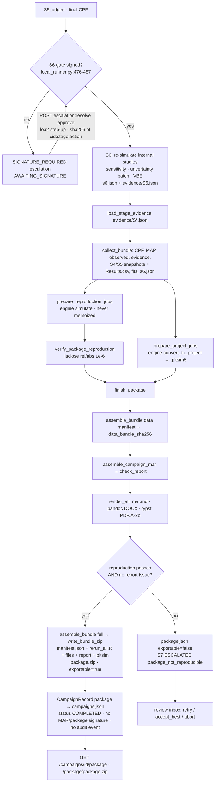

# C — Stage S7 and compliance: report, package, reproducibility, signatures, audit

Read-only audit of `/workspace/Modeler_One_AI` at `1dbda7f` (main, 2026-11-25). The scope is what happens after the MAP
is signed, up to the downloadable package. Every claim cites `file:line`. **VERIFIED** means I read the code (and in
three places ran a pure in-memory check). **INFERRED** means a reasoned conclusion I did not execute. Nothing in the repo
was modified.

---

## 1. Summary

- **What exists and is wired (single-node `LocalExecutor` only).** S7 is `LocalExecutor._run_package`
  (`services/orchestrator/src/modeler_orchestrator/local_runner.py:783-832`). In order, it:
  1. loads the per-stage evidence JSON;
  2. assembles a data bundle;
  3. re-runs the S4 and S5 snapshots on new engine subprocesses, which are never memoized;
  4. compares their `*-Results.csv` tables at 1e-6;
  5. converts the snapshots to `.pksim5`;
  6. builds and lints the campaign MAR and renders it to MD, DOCX and PDF/A-2b (pandoc and typst);
  7. writes `package.zip` only when reproduction passed **and** the MAR lint found no issue
     (`package_activities.py:411-419`).

  The API serves the package summary and the downloads (`read_api.py:195-234`). The web campaign page has a
  "Package (S7)" tab (`apps/web/app/campaigns/[campaignId]/page.tsx:294-344`).
- **The Temporal path does not run S6 or S7.** It records them as SKIPPED (`campaign.py:356-364`).
  `ingest_results` is a placeholder (`activities.py:25-30`).
- **Never signed:** the MAR, the package and the final CPF. In the local path no QA release exists. The campaign MAR is
  built with no signatures (`campaign_mar.py:414-420`). The run ends COMPLETED right after S7 (`local_runner.py:584-591`).
- **Only one post-MAP signature exists:** the S4/S5 "evaluation" gate before S6. It binds to
  `sha256("{campaign}:{stage}:{action}")`, not to the evaluation's content (`escalations.py:266-267`).
- **Most surprising findings (all CONFIRMED):**
  1. **An escalated stage that a signed decision accepted gets no evidence file.** Its status is ESCALATED, and
     `_persist` runs only for non-stop statuses (`local_runner.py:554-556`); `accept_best` never writes it
     (`local_runner.py:1277-1286`). The MAR then says the stage "ended **not run**". If that stage is S4 or S5, its
     snapshot is neither bundled nor reproduced. The signed S5 limitation ("context of use restricted") never reaches
     the MAR's limitations section.
  2. **A VBE that did not run blocks the package.** The template name `vbe-crossover 0.2.0-draft` lands in the
     Prediction prose (`campaign_mar.py:182-186`). The bare-number linter flags `0.2` (I reproduced this in memory:
     `unreferenced_number`, section 6), so the package is withheld.
  3. **The zip is not byte-reproducible, and its manifest covers neither itself nor `rerun_all.R`.**
     `ZipFile.writestr` stamps the current time. I showed in memory that two builds give different bytes. The
     recorded `package_sha256` is a hash over the file list, not over the zip (`reproducibility.py:44-47, 189-209`).
  4. **Tamper detection at rest is library-only.** `verify_bundle_integrity` is called only in tests. `rerun_all.R` is
     never executed by the platform: the gate uses the engine's own `simulate` task.
  5. **`escalation:decide` and `deviations` (the Temporal path) break the rules.** They take a **password and second
     factor in the request body** and the tenant from a header, with no bearer auth. Their verifier always returns 503,
     and their signatures never reach the audit trail (`escalations.py:83-84, 100-179`).
  6. **A DEV-verifier signature looks like a real step-up.** It is recorded as `auth_method = "oidc:loa2"`, the same
     string a real Keycloak step-up produces (`compliance/signatures.py:114`, `auth.py:102`). Neither the MAR nor the
     zip records the engine kind or the deployment. A stub-engine campaign therefore releases an "exportable" package
     that carries no fixture label (the test asserts `exportable`: `test_local_runner.py:551`).
  7. **The orchestrator writes no audit events at all.** That covers stage outcomes, the reproduction verdict and the
     package release. Downloads are not audited either.
- **What has run on real PK-Sim, from the records (not re-verified here):**
  - a known-truth (synthetic) campaign: S7 "reproduced 7 of 7 result tables and released a 147-file package"
    (`CHANGELOG.md:11396-11400`);
  - the T-56 Dapagliflozin campaign of 2026-10-22, on a pilot with the DEV token. Its PQ is **incomplete**
    (`CHANGELOG.md:7440-7444, 7502-7515`).
  - IQ: "Not yet run on the server" (`docs/CONTINUATION_PACKAGE.md:732`).
  - `.pksim5`: "not yet run in a campaign on the server" (`docs/CONTINUATION_PACKAGE.md:676`).

---

## 2. Module inventory

| Module | Path | Responsibility | Called by | Calls | Lines |
|---|---|---|---|---|---|
| package_activities | services/orchestrator/src/modeler_orchestrator/package_activities.py | S6 jobs/reduction; S7 evidence I/O, bundle, re-run jobs, .pksim5 jobs, verdict, MAR+zip | local_runner.py:717,735,786-819 only (not campaign.py/workflows.py) | pbpk_domain.reproducibility, report.*, campaign.prediction, engine contracts | 428 |
| local_runner (S6/S7 parts) | services/orchestrator/src/modeler_orchestrator/local_runner.py | S6 gate (signature), `_run_prediction`, `_run_package`, `_persist`, `resolve_escalation` | API execution backend `local`; escalations.py:273 | package_activities, memo | 1411 |
| memo | services/orchestrator/src/modeler_orchestrator/memo.py | memoized engine; exempts `-S7-rerun-` jobs | local_runner.py:1078-1086 | engine | 119 |
| campaign (Temporal) | services/orchestrator/src/modeler_orchestrator/campaign.py | Temporal campaign; S6/S7 SKIPPED; final-CPF signal | Temporal worker | activities | 431 |
| activities | services/orchestrator/src/modeler_orchestrator/activities.py | `ingest_results` placeholder | workflows.py:48-52 | — | 35 |
| reproducibility | packages/pbpk-domain/src/pbpk_domain/reproducibility.py (locked) | manifest, integrity, 1e-6 compare, rerun_all.R, zip | package_activities.py:340,377 | stdlib | 209 |
| report.mar | packages/pbpk-domain/src/pbpk_domain/report/mar.py | MAR model, reference tokens, lint, Markdown, evidence index | campaign_mar, render, package_activities | m15 | 439 |
| report.campaign_mar | packages/pbpk-domain/src/pbpk_domain/report/campaign_mar.py | campaign MAR (sections 1–9, M15 tables) | package_activities.py:374,388 | mar, m15, map, cpf, system | 420 |
| report.render | packages/pbpk-domain/src/pbpk_domain/report/render.py | DOCX (pandoc), PDF/A-2b (pandoc→typst; LaTeX fallback) | package_activities.py:376,394 | pandoc, typst, gs | 135 |
| report.validation_pack | packages/pbpk-domain/src/pbpk_domain/report/validation_pack.py | URS/FS, RTM, OQ, IQ, PQ checks, Markdown | CI (ci.yml:60-71), run_t56.py:372, CLI | yaml, junit | 298 |
| m15 | packages/pbpk-domain/src/pbpk_domain/m15.py (locked) | M15 table model, allowed risk, completeness | campaign_mar, system_api.py:89-103, proposal_intake | — | 109 |
| compliance.signatures | services/api/src/modeler_api/compliance/signatures.py (locked) | Signature, `sign_record` (password), `sign_after_step_up` | signatures_api, plan_api, escalations, delivery_routes, dataroom_api | — | 119 |
| auth | services/api/src/modeler_api/auth.py (locked) | JWKS verifier, DevVerifier, `ensure_step_up` | all routers | PyJWT | 169 |
| part11 (API) | services/api/src/modeler_api/part11.py | `record_signature` (audit event + PG row), `verify` CLI | every signing route | modeler_storage.part11, FileProjectStore | 82 |
| signatures_api | services/api/src/modeler_api/signatures_api.py | generic POST/GET signatures | web `signMap` (writes.ts:13-21), history page | part11, auth | 85 |
| escalations | services/api/src/modeler_api/escalations.py | Temporal `:decide`/deviations; local `:resolve` | web `resolveEscalation` (writes.ts:33-35) | local_runner.resolve_escalation | 284 |
| run_guard | services/api/src/modeler_api/run_guard.py | campaign start needs a signed MAP | campaign_api | audit chain | 105 |
| ownership | services/api/src/modeler_api/ownership.py | owner-only writes; reviewer may sign | main.py:87-107 | memberships | 65 |
| read_api (S7 part) | services/api/src/modeler_api/read_api.py | package summary + downloads | web Package tab | FileReadStore | 307 |
| results_api / results/* | services/api/src/modeler_api/results_api.py, results/{ingest,query}.py | Parquet read API; CSV→Parquet library | API (read); ingest: tests only | duckdb, pyarrow | 58 / 143+47 |
| storage.audit | packages/storage/src/modeler_storage/audit.py (locked) | PG hash chain, `append_audit_event` | db/repositories.py (Temporal path) | SQLAlchemy | 128 |
| storage.part11 | packages/storage/src/modeler_storage/part11.py | PG mirror of file chain, signature rows, verify | api/part11.py | asyncpg | 217 |
| storage.objects | packages/storage/src/modeler_storage/objects.py | S3/MinIO + presign (not used by S7) | engine plane | boto3 | 96 |
| storage.records/filestore | packages/storage/src/modeler_storage/{records,filestore}.py | `CampaignRecord.package` JSON; file stores | runner, API | — | 176 / 203 |
| project audit | packages/project-model/src/modeler_project/audit.py (locked) | file hash chain `audit.jsonl`, mirror hook | every audited API action | — | 117 |
| T-56 kit | deploy/proof/run_t56.py, README.md | prepare/accept/start/trace; writes trace.md, pq.json | operator | API | 461 |
| IQ | deploy/server/qualify.sh, qualify.py | 10 IQ checks → iq/1 JSON | operator | — | 13 / 222 |
| URS/FS | docs/validation/requirements.yaml (locked) | 44 requirements | validation_pack | — | 320 |
| trace plugin | conftest.py | req marker → trace-matrix.{md,json} | CI | — | 48 |
| web Package tab | apps/web/app/campaigns/[campaignId]/page.tsx; components/PackageDownloads.tsx | show verdict, hashes, issues; download | browser | GET package, GET package/{artifact} | 347 / 53 |

---

## 3. Feature table

| Feature | Purpose | Inputs | Outputs | Source | Status | Evidence note |
|---|---|---|---|---|---|---|
| Stage evidence persistence | survive the S6 signature pause | StageOutcome + writer rounds/notes + `_last` | `campaigns/<id>/evidence/<stage>.json` | local_runner.py:715-730; package_activities.py:59-69 | partial | not written for ESCALATED stages later accepted (local_runner.py:554-556) |
| Data bundle | files for re-run | CPF, MAP, observed, evidence, S4/S5 snapshots + Results.csv, fits, s6.json | dict path→bytes, numeric set | package_activities.py:252-291 | implemented | S4/S5 only (l.268); no pkml, raw client files, figures, audit chain |
| Fresh-engine re-run | D13 reproducibility | bundled snapshots | engine `simulate` manifests | package_activities.py:294-307; memo.py:32-35,88-89 | implemented | new subprocess, same host/engine; not via rerun_all.R |
| 1e-6 table comparison | numeric equality | original vs re-run CSVs | verdicts | reproducibility.py:107-147; package_activities.py:337-353 | implemented | `isclose(rel_tol=1e-6, abs_tol=1e-6)` (l.123) |
| Tamper detection at rest | detect edits | manifest + files | ReproReport | reproducibility.py:89-104 | library-only | called only in tests |
| rerun_all.R | reviewer re-run | manifest | R script in zip | reproducibility.py:155-186,205-206 | partial | never executed by platform; no comparison script; not in manifest |
| .pksim5 projects | open in PK-Sim | snapshots | `pksim/<stem>.pksim5` | package_activities.py:310-334; run_job.R:159-162 | implemented (unproven in a server campaign) | continuation §4.1 l.676 |
| Package zip | the deliverable | full file set | `package/package.zip`, `package.json` | package_activities.py:411-420 | implemented | released only if reproduction passes and lint is clean |
| Campaign MAR | ICH M15 App. 2 report | MAP, CPF, evidence, S6, reproduction, ledger | MarDocument | campaign_mar.py:238-420 | partial | no signatures, figures, exec summary/discussion |
| MAR lint | no untraced number | MarDocument | ReportIssue list | mar.py:163-197 | implemented | tables not linted; verbatim sections exempt |
| Renderers | MD/DOCX/PDF-A | Markdown | mar.md/.docx/.pdf | render.py:65-124 | implemented | PDF/A not validated; DOCX error not caught |
| M15 table | credibility | MAP risk_assessment | rendered table | campaign_mar.py:152-176,387-413; mar.py:298-310 | partial | 4 rated rows only; impact/text fields empty or not rendered |
| Generic signature | Part 11 sign any record | meaning, type, id, client sha | audit event (+PG row) | signatures_api.py:26-49 | implemented | client-supplied hash; no per-meaning role |
| MAP sign (plan) | sign MAP | plan | signed MAP + signature | plan_api.py:522-561 | implemented | pre-S7 (context) |
| Evaluation gate signature | S4/S5 before S6 | escalation | signature + resume | escalations.py:219-284; local_runner.py:476-487 | implemented | binds label hash, not content |
| Temporal decide/deviation | Temporal path | password+TOTP in body | signal | escalations.py:139-179 | placeholder | verifier 503; unaudited |
| Final CPF / MAR / QA release signature | close campaign | — | — | campaign.py:396-404 (Temporal only) | absent (local) | no sender for `accept_final_cpf` |
| File audit chain | 11.10(e) | events | audit.jsonl | modeler_project/audit.py:62-117 | implemented | detects edits, not tail truncation |
| PG Part 11 copy | production records | file lines | audit_events, signatures | storage/part11.py:102-146; migrations 0001/0004 | implemented (prod only) | append-only triggers + grants |
| Part 11 verify | nightly check | file chain + DB | problems | storage/part11.py:159-217; api/part11.py:62-78 | partial | misses file truncation; signatures not compared |
| Validation pack | GAMP IQ/OQ/PQ | URS, RTM, JUnit, iq/pq JSON | Markdown | validation_pack.py:173-294 | implemented | CI renders OQ only (ci.yml:60-71) |
| IQ | installation | server | iq/1 JSON | qualify.py | implemented, not run on server | continuation l.732 |
| PQ | performance | T-56 campaign facts | pq/1 JSON | validation_pack.py:93-125; run_t56.py:367-386 | implemented; PQ incomplete | CHANGELOG 7440-7444 |
| Package API | summary | campaign record | JSON | read_api.py:195-212 | implemented | — |
| Download API | files | artifact name | FileResponse | read_api.py:215-234 | implemented | file:// only; no integrity re-check; no audit |
| Web Package tab | show S7 | GET package | panel + buttons | page.tsx:294-344; PackageDownloads.tsx | implemented | misattributes withheld reason (l.308-310) |
| Run results API | Parquet series | run id | JSON | results_api.py:34-58 | unwired | no producer; path mismatch with ingest |

---

## 4. Detailed findings

### Q1. The bundle and the reproducibility gate

**Assembly (VERIFIED).** `collect_bundle` (`package_activities.py:252-291`) gathers the following.
- `cpf/final.json`, `map/map.json`, `data/observed.json` and, for a model system, `cpf/system.json` (l.260-264).
- `evidence/<stage>.json` for every persisted stage (l.265-266). These are re-serialised and contain server `file://`
  URIs (`cpf_uri`, `snapshot_uri`, output URIs; `local_runner.py:721-726`).
- **For S4 and S5 only** (l.268): the snapshot `snapshots/<stage>-<cid>.json` and each engine output
  `snapshot-<Sim>-Results.csv`, renamed `results/<stem>/<stem>-<Sim>-Results.csv` and marked numeric (l.273-280).
- Fit files `fits/<run>/start-NNN/pi_*.json` for each `provenance.run` in the final CPF (l.282-287). The engine writes
  both `pi_spec.json` and `pi_result.json` there (`run_job.R:324`, `run_pi.R:423`).
- `prediction/s6.json` (l.288-290). That file is written by `evaluate_s6` **before** the VBE result is added in memory
  (`package_activities.py:238-240` vs `local_runner.py:751-754`). The VBE result is therefore present only in
  `evidence/S6.json`.

`finish_package` adds `report/mar.{md,docx,pdf}` and `pksim/<stem>.pksim5` (l.412-415).

**Manifest (VERIFIED).** `BundleManifest` holds `bundle_id`, `campaign`, `files`, `engine_image_digest`,
`software_versions` and `created_at` (`reproducibility.py:35-42`). Each file entry has `path`, `sha256`, `size_bytes`
and `numeric`. `content_sha256` is SHA-256 over sorted `path:sha:size:numeric` lines (l.44-47).

The zip's `manifest.json` (l.194-202) writes `bundle_id`, `campaign`, `engine_image_digest`, `software_versions`,
`content_sha256` and `files`. It does **not** write `created_at` or seeds; seeds exist only inside `map/map.json`.

Two manifests are built:
- `<cid>-data`, over the data files: its hash goes into the MAR (`package_activities.py:381-382, 389`);
- `<cid>-package`, over data + report + pksim: its `content_sha256` is recorded as `package_sha256` (l.416-419).

Neither manifest lists `manifest.json` or `rerun_all.R`. I confirmed in memory that `rerun_all.R` is absent from
`files`. The zip bytes are timestamped by `writestr`, so they vary between builds (in-memory check: different SHA-256
when the clock moves). No hash of the zip bytes is stored or shown.

**rerun_all.R (VERIFIED).** It is generated from the snapshot list (`reproducibility.py:155-186`). It calls
`initPKSim()` and `runSimulationsFromSnapshot(snap, output=od, exportCSV=TRUE)` into `<out>/<stem>/`, and pins the
image digest only in a comment ("UNSET" if empty). It ships only when the bundle has snapshots (l.205-206). The
platform never runs it: the gate re-runs each snapshot through the engine's `simulate` task
(`package_activities.py:294-307`; `run_job.R:146-157`). No comparison script ships with it. The tests only check the
script's text (`test_reproducibility.py:144-162`).

INFERRED: `<out>/<stem>/<stem>-<Sim>-Results.csv` matches the bundle's `results/` layout, because PK-Sim names
outputs `<snapshot>-<Sim>-Results.csv` (`run_job.R:71`).

**.pksim5 (VERIFIED).** `prepare_project_jobs` writes `package/project/<stem>.json` and submits `convert_to_project`
(`package_activities.py:310-324`). `run_job.R:159-162` calls
`loadProjectFromSnapshot(..., runSimulations=FALSE)` and lists `*.pksim5`. A failed conversion becomes
`project_notes`; it does not block the release (`local_runner.py:806-812`). These jobs are memoizable: only
`-S7-rerun-` is exempt (`memo.py:35`).

**Gate (VERIFIED).**
- Re-run jobs are named `<cid>-S7-rerun-<stem>` and always reach the engine (`memo.py:32-35, 88-89`). Each is its own
  subprocess (`local_runner.py:1060-1069`).
- `verify_package_reproduction` compares only `snapshot-*-Results.csv` (`package_activities.py:343-353`). It passes
  only when there is at least one table (l.352). Cells are equal as strings, or `math.isclose(fa, fb, rel_tol=1e-6,
  abs_tol=1e-6)` (`reproducibility.py:116-124`). Row and column counts must match.
- Release rule: `reproduction["passes"] and not issues` (`package_activities.py:411`). Otherwise
  `package.json.exportable=false` and S7 ESCALATES with `package_not_reproducible` (`local_runner.py:827-832`). The
  escalation options are retry, accept_best and abort (`local_runner.py:92-96, 419`). Accepting the best closes the
  campaign with no package.
- "Fresh engine" means a new process on the same host, with the same R libraries and engine command. It is not the
  "fresh engine pod" re-running `rerun_all.R` that `docs/ENGINEERING_PLAN.md:134-141` specifies (INFERRED
  equivalence for determinism only).
- Tamper detection: `verify_bundle_integrity` (`reproducibility.py:89-104`) has no production caller (grep). The
  download serves whatever file the record's path names (`read_api.py:226-234`).

### Q2. MAR (ICH M15 Appendix 2)

**Sections (VERIFIED, `campaign_mar.py:373-386`).**
1. Objective and context of use (verbatim).
2. Data (`{{table:studies}}`).
3. Model description (`cpf_final`, plus the system tables).
4. Model development: 4.x for S1, S2, S3 and, when evidence exists, SM and SJ, plus 4.n development history.
5. Model evaluation: 5.1 S4, 5.2 S5.
6. Prediction: sensitivity, prediction intervals, VBE.
7. Reproducibility.
8. Assumptions and limitations (verbatim; drawn from `split_limitations`, stage notes and S6 notes).
9. Conclusion.

After the sections come the ICH M15 assessment tables and the Evidence index (`mar.py:219-224`).

Missing against `docs/ARCHITECTURE_PACK.md:829-836`: an Executive Summary, an Introduction and a Discussion. The
drafting agents F-504 and F-505 do not exist (grep).

**Where numbers come from (VERIFIED).**
- Prose numbers are `{{value:id}}` tokens resolved at render time from `Evidence.values` (`mar.py:263-283`). These
  include `acceptance_tier`, `internal_target_pe`, `model_system_sha256`, the per-stage `{auc,cmax}_gmfe_<stage>` from
  the last round (`campaign_mar.py:294-299`), `reproduced_tables` and `data_bundle_sha256`.
- Tables (`TableRef`) take their cells from stage metrics, the CPF, S6 and the ledger. Cells are not linted.
- The "evidence index" lists each id with a free-text `source` label, such as "stage S4 final round AUC GMFE"
  (`mar.py:313-324`). It does not resolve to a file or hash. The T-56 "every number traced" check only tests that the
  label is non-empty (`run_t56.py:358-360`), which is true by construction.

**Lint (VERIFIED).** `check_report` flags unresolved tokens and bare numbers in non-verbatim prose (`mar.py:163-188`,
regex l.27). The S7 render is non-strict when issues exist (`package_activities.py:394`). The issues are stored
(l.400) and the MAR stays downloadable (`read_api.py:190-192`). The URS T-24 FS says "render refuses"
(`requirements.yaml:122`); S7 renders anyway and withholds only the zip.

**Renderers (VERIFIED).**
- `mar.md` is always written.
- DOCX comes from `pandoc -f markdown -t docx` (`render.py:65-71`).
- PDF/A-2b: pandoc converts to Typst, then `typst.compile(..., pdf_standards="a-2b")` (l.80-92). The fallback is
  LaTeX `pdfx` plus Ghostscript (l.93-99).
- pandoc comes from `pypandoc-binary` 1.17 and Typst 0.15.0, both pinned (`uv.lock:1842-1843, 2546-2547`;
  `services/orchestrator/pyproject.toml:12-13`).
- A PDF failure is caught and recorded in `report_notes` (`render.py:118-123`; `package_activities.py:408-410`). A
  DOCX failure is **not** caught (`render.py:114-117`), and would bubble up to the stage-level `except` and FAIL S7
  (`local_runner.py:524-530`; INFERRED).
- No PDF/A validator (veraPDF) runs.

**Report issues reproduced (VERIFIED, in-memory).** With a VBE that did not run, the MAR reports
`kind='unreferenced_number' location='6' detail="bare number '0.2' in prose"`. The source is the template name in
`campaign_mar.py:182-186`. The existing test checks that text but not `check_report` (`test_vbe_report.py:49-54`).

**What is missing (VERIFIED).**
- **The MAR is not signed.** `MarDocument.signatures` is empty (`campaign_mar.py:414-420`), so the `## Signatures`
  block never renders (`mar.py:226-230`). Not even the MAP's signature is shown.
- No figures: the campaign MAR has no `FigureRef`, so no VPC or GOF plots.
- No engine kind (pksim versus fixture) and no deployment kind. The front matter has only the MAP's
  `engine_image_digest` and software versions (`mar.py:234-250`).
- Markdown table cells are not escaped (`mar.py:286-290`); compare `validation_pack._cell`, l.258-259. INFERRED: a
  PK-Sim path with `|` falling back as a sensitivity "parameter" (`package_activities.py:161`) would break the table.

### Q3. M15 credibility table

**VERIFIED.**
- Model: `AssessmentTable` has QoI, COU, the four rated elements (influence, consequence, risk, impact), and the text
  fields `technical_criteria`, `appropriateness_of_proposed_midd`, `evaluation_of_models_and_outcomes` and
  `outcome_of_midd_evidence_assessment` (`m15.py:47-61`).
- `allowed_model_risk` (l.30-38) and `validate_table` (l.67-109) exist. They are exposed only via
  `POST /api/v1/m15/validate` (`system_api.py:89-103`), which the web does not call (grep). They are **not** run at S7.
- Capture: influence, consequence, why and tier justification come from the Start brief into
  `MapRiskAssessment` (`modeler_project/plan.py:372-385, 422, 486`; `campaign/map.py:320-332, 364`). They are hashed
  with the MAP when set (`map.py:369-376`).
- In the MAR, `_m15_ratings` copies them, with "kept against suggestion" reasons (`campaign_mar.py:152-176`). A MAP
  without an assessment shows only the tier.
- So the continuation table's "M15 influence/consequence capture" gap (`CONTINUATION_PACKAGE.md:676`) is **partly
  stale**: capture exists for plan-built MAPs. However:
  - `model_impact`, `appropriateness_of_proposed_midd` and `outcome_of_midd_evidence_assessment` are never filled;
  - `technical_criteria` and `evaluation_of_models_and_outcomes` are filled (`campaign_mar.py:390-394`) but **never
    rendered**: `_render_m15_table` prints only the four rated rows plus QoI and COU (`mar.py:298-310`);
  - the VBE M15 table ignores the MAP's assessment and hard-codes "recorded by the modeler"
    (`campaign_mar.py:405-406`).

### Q4. Signatures

**Mechanics (VERIFIED).**
- Meanings: Authored, Reviewed, Approved, QA Released (`compliance/signatures.py:18-22`).
- `sign_after_step_up` sets `auth_method=f"oidc:{acr}"` (l.88-115). It checks only that the hash is 64 characters.
- `ensure_step_up` requires `acr == "loa2"` and `auth_time` within 300 s (`auth.py:23-24, 163-169`).
- `record_signature` first appends a `signature.create` audit event (actor, resource type/id, the manifestation as
  `reason`, and `after={signature_id, record_sha256, meaning, auth_method}`). In production it then inserts a
  `signatures` row (`api/part11.py:39-59`). The two writes are separate, so a failed row insert leaves the audit event
  behind (INFERRED risk).
- `is_signature_valid` compares hashes (l.118-119). It has no caller outside tests (INFERRED from grep of
  `sign_after_step_up`/`is_signature_valid` usage).

**Which records are signed after the MAP (VERIFIED).**

| Record | Route | record_sha256 binds | Meaning | Who |
|---|---|---|---|---|
| MAP (plan path) | `POST /projects/{id}/plan:sign` (plan_api.py:522-561) | `MapDocument.content_sha256()`, computed server-side (l.556) | Approved | `modeler-reviewer` (MiddLead, plan_api.py:68) + owner_guard |
| MAP approval (web) | `POST /projects/{id}/signatures`, `record_type=map_approval` (writes.ts:13-21) | client-supplied; checked later against the MAP bytes at campaign start (run_guard.py:62-65) | Approved | owner or reviewer (ownership.py:18-35, 54-65); no role per meaning |
| S4/S5 evaluation gate before S6 | `escalation:resolve` with `approve` (escalations.py:219-284) | `sha256("{cid}:{stage}:{action}")` (l.266-267); feedback decisions hash their payload (feedback.py:281-284) | Approved (`DECISION_MEANING`, l.47), not "Reviewed" as ENGINEERING_PLAN §6 says | owner or reviewer (l.239); no separation of duties |
| Stage escalation decisions (retry / accept_best / abort / learn / new_evidence) | same | same | Approved | same |
| Temporal `:decide` / deviations | escalations.py:139-179 | client-supplied | Approved | **no bearer auth**; `X-Tenant-Id` header; password + TOTP in body; `get_verifier` always 503 (l.83-84); **not** recorded in the audit trail |
| MAR, package, final CPF, QA release | — | — | — | **none in the local path**; Temporal waits on `accept_final_cpf` (campaign.py:396-404), but no API sends it (grep) |

**Signature manifest.** The manifestation is `printed_name | meaning | YYYY-mm-dd HH:MM:SS UTC`
(`compliance/signatures.py:53-54`). The register lists `signature.create` events and `chain_verifies` from the file
chain only (`signatures_api.py:57-85`). The package does not include a signature manifest. The MAP signature
(`MapSignature`: printed name, meaning, signed_at, signature_id, content hash; `map.py:270-276, 389-401`) travels
inside `map/map.json`.

**Storage.** Development and pilot keep the file chain only. Production requires `MODELER_PART11_STORE=postgres` and
refuses to start otherwise (`config.py:74-84`; `main.py:50-51`). The `signatures` table is append-only by trigger and
by grants (`migrations/0001_core.sql:87-129`; `0004_part11_records.sql:5` makes `record_id` text;
`deploy/server/postgres.sh:136-145`).

**DEV verifier caveat (VERIFIED).**
- `DevVerifier` accepts any token and returns a principal with all reviewer roles, projects `*`, `acr=loa2` and
  `auth_time=now` (`auth.py:90-103`). Every request therefore counts as a fresh step-up.
- Production refuses it (`config.py:65-71`). A pilot may run it.
- A DEV signature is stored with `auth_method "oidc:loa2"`, the same as a Keycloak step-up. Only the signer id
  (`dev-user`) and the campaign's `deployment` field tell them apart. The PQ treats a non-production run as a FAIL
  (`validation_pack.py:108-111`).
- `run_guard.map_signed` accepts a MAP file whose own JSON says `status:"SIGNED"` with any `signature`, without
  checking the hash or the audit chain (`run_guard.py:56-57`; POTENTIAL).

### Q5. Audit trail

**Structure (VERIFIED).**
- Events have `tenant_id`, `seq`, `occurred_at` (app clock, ISO UTC), `actor`, `action`, `resource_type`,
  `resource_id`, `before`, `after`, `reason` and `request_id` (`storage/audit.py:24-36`;
  `modeler_project/audit.py:24-36`).
- Chaining: `row_hash = SHA-256(prev_hash | canonical JSON)`, with sorted keys and compact separators. Genesis is 64
  zeros (`storage/audit.py:46-56`; `project/audit.py:39-44`).
- Verification returns the first broken index (`storage/audit.py:59-66`; `project/audit.py:110-117`).

**File chain.** `<read_root>/<tenant>/audit.jsonl` is written under a thread lock and `flock`
(`project/audit.py:82-108`). It calls `flush()` but not `fsync`. It is append-only by convention only: editing a line
breaks verification, but **removing the tail does not**.

**Postgres copy (production).**
- `Part11Store.mirror_audit` inserts the record, after any rows the DB lacks, in one transaction **before** the file
  line is written (`storage/part11.py:102-126`; `project/audit.py:100-105`). It refuses when the DB is ahead
  (l.116-118).
- `verify` checks that the DB chain recomputes and that every file line is in the DB (l.159-177). It does **not**
  report DB rows missing from the file (a truncated file), and it does not compare signatures. The test only shows
  that a shortened chain blocks the next append (`test_part11_postgres.py:102-114`).
- Append-only: triggers reject UPDATE, DELETE and TRUNCATE on `audit_events`, and UPDATE and DELETE on `signatures`
  (`0001_core.sql:118-129`). UPDATE, DELETE and TRUNCATE are revoked from the API login (`postgres.sh:141-145`).

**A second writer.** `append_audit_event` (`storage/audit.py:83-128`) is used by `CampaignRepository` on the Temporal
path (`db/repositories.py:16-35`). It hashes the UUID tenant, while the mirror hashes the slug. INFERRED: both writing
one tenant would conflict.

**What is audited.** Signatures, blinding, dataset reveal, members, archive, intake, Data room and admin actions (grep
of `.append(`). **Not audited:** campaign start, stage outcomes, S7 reproduction or package release, report
generation and downloads. There is no `audit` reference in `services/orchestrator/src`, `read_api.py`,
`campaign_api.py` or `execution.py`. ENGINEERING_PLAN §6 cites `compliance/audit.py`, which does not exist.

### Q6. Validation pack

**VERIFIED.**
- URS/FS: `docs/validation/requirements.yaml` (locked), version 2 "DRAFT for QA review", 44 requirements (l.6-12).
- Trace matrix: `conftest.py:27-48`, built from **collected** test items with `req` markers. A skipped or failed test
  still counts as "traced" (`validation_pack.py:133-135`). CI writes `reports/trace-matrix.{md,json}` and
  `junit.xml`, then renders a pack with **OQ only** (`ci.yml:59-83`).
- IQ: `qualify.sh iq` runs 10 checks (`qualify.py:8-17`).
- PQ: `pq_checks` covers PQ-01 to PQ-08 (`validation_pack.py:93-125`) and is fed by `run_t56.py trace` facts
  (`run_t56.py:367-386`).
- Verdicts: PASS, FAIL or INCOMPLETE; a missing check reads as INCOMPLETE (l.68-74).

**What has run (records).**
- OQ: every CI run (artifact `validation-evidence`).
- IQ: not run on the server (`CONTINUATION_PACKAGE.md:732`).
- PQ: T-56 on 2026-10-22, real PK-Sim, MAR issues 0, reproduction passed, 9 min (`CHANGELOG.md:7502-7515`). It is
  INCOMPLETE because PQ-02 (deployment) was not recorded (`CHANGELOG.md:7443`), and it ran with `--token dev`. A
  production PQ has not been produced.

**URS claims that overstate the code (CONFIRMED).**
- F-401 "the MAR renders … the signatures" (`requirements.yaml:297`).
- T-24 "render refuses".
- T-05 "a verify command checks both" (it misses truncation).
- T-23 "Hashed bundle plus generated rerun_all.R" (the script is not hashed).

### Q7. API endpoints

See section 6.

### Q8. Wired versus library-only

- **Wired, LocalExecutor only:** S6 gate signature, S6, S7 evidence, bundle, re-run, .pksim5, MAR, render, zip,
  package API, download API and the web tab. The docstring's "re-run … exactly as a reviewer would" is a re-run on
  the platform engine.
- **Temporal:** S6 and S7 SKIPPED (`campaign.py:356-364`); `ingest_results` is a stub; no MAP or final-CPF signal
  senders; `:decide` returns 503.
- **Library or test-only:** `verify_bundle_integrity`; `rerun_all.R` execution; `validate_table` at S7; MAR
  `signatures`/`FigureRef` (supported by `assemble_mar`, `mar.py:330-419`, but the campaign path uses
  `assemble_campaign_mar`); `results.ingest`; `S3ObjectStore` for S7 (S7 and downloads need `file://`:
  `package_activities.py:31-53`, `read_api.py:168-172`).
- The continuation task table still says "T-23, T-24, T-32 Done as libraries — not wired into campaigns (R9)"
  (`CONTINUATION_PACKAGE.md:732`). That is **stale for T-23 and T-24**, which are wired into the local S7.

---

## 5. The bundle as a directory tree

Server side: `<object store>/tenants/<t>/campaigns/<cid>/` (`package_activities.py:49-53`).

```
campaigns/<cid>/
├── evidence/S0.json … S6.json [SJ.json, SM.json]     persisted per finished, non-stopped stage
├── s6/s6.json                                         sensitivity + intervals (no VBE)
└── package/
    ├── rerun/<stem>.json, rerun/<stem>/…               S7 re-run inputs/outputs
    ├── project/<stem>.json, project/<stem>/*.pksim5    convert_to_project
    ├── report/mar.md, mar.docx, mar.pdf                always md; docx/pdf when pandoc/typst work
    ├── package.json                                    the record (also stored in campaigns.json)
    └── package.zip                                     only if reproduction passed and no report issue
```

Inside `package.zip` (`reproducibility.py:203-208`; `package_activities.py:252-291, 412-416`):

```
package.zip
├── manifest.json            bundle_id "<cid>-package", campaign, engine_image_digest, software_versions,
│                            content_sha256, files[{path, sha256, size_bytes, numeric}]  (not self, not rerun_all.R)
├── rerun_all.R              only when snapshots/ is non-empty
├── cpf/final.json           final CPF
├── cpf/system.json          model system only
├── map/map.json             signed MAP (with MapSignature, seeds)
├── data/observed.json       observed PK (JSON; no raw client files, no CSV)
├── evidence/<stage>.json    stage evidence (server file:// URIs inside)
├── snapshots/S4-<cid>.json, snapshots/S5-<cid>.json
├── results/S4-<cid>/S4-<cid>-<Sim>-Results.csv  (numeric)  … same for S5
├── fits/<cid>-<stage>-r<n>/start-NNN/pi_spec.json, pi_result.json   (cycle ≥2 fits missed, §8)
├── prediction/s6.json
├── report/mar.md, report/mar.docx, report/mar.pdf
└── pksim/S4-<cid>.pksim5, pksim/S5-<cid>.pksim5    when converted
```

Compared with the promises in `ENGINEERING_PLAN.md:134-141` and `WORKFLOW_AND_AUTOMATION.md:173-188`, the zip lacks:
pkml simulation files, results Parquet, raw client files, figures, a standalone M15 table, signatures, the audit
chain, V&V and qualification reports, a signed report, and seeds in the manifest.

---

## 6. API table

| Method | Path | Purpose | Auth / roles | Request | Response | Source |
|---|---|---|---|---|---|---|
| GET | /api/v1/campaigns/{campaign_id} | monitor, includes `package` record | bearer; viewer/curator/reviewer/qa; project member | — | CampaignRecord | read_api.py:141-155 |
| GET | /api/v1/campaigns/{campaign_id}/package | S7 summary | same | — | exportable, reproduction, data_bundle_sha256, package_sha256, files, report_notes, report_issues, artifacts, pksim_projects, project_notes | read_api.py:195-212; views/campaigns.py:48-60 |
| GET | /api/v1/campaigns/{campaign_id}/package/{artifact} | download `package.zip`, `mar.md`, `mar.docx` or `mar.pdf` | same | artifact | FileResponse; 409 zip withheld; 404 outside the object store | read_api.py:160-165, 215-234 |
| POST | /api/v1/projects/{project_id}/signatures | generic Part 11 signature | bearer; project member; owner_guard (owner, or reviewer on this signing route); loa2 ≤300 s | meaning, record_type, record_id, record_sha256 | signature_id, manifestation, record_sha256, auth_method, signed_by | signatures_api.py:26-49; main.py:90; ownership.py:18-35 |
| GET | /api/v1/projects/{project_id}/signatures | signature register | READ_ROLES | — | chain_verifies, signatures[] | signatures_api.py:56-85 |
| POST | /api/v1/projects/{project_id}/plan:sign | sign MAP from plan | modeler-reviewer + owner_guard + loa2 | note | PlanSigned | plan_api.py:522-561 |
| POST | /api/v1/campaigns/{campaign_id}/stages/{stage}/escalation:resolve | signed decision, including the S6 gate `approve` (local backend only) | bearer; project member; ensure_owner(signing); loa2 | action, note, studies, beyond_cap, evidence | result + signature | escalations.py:199-284 |
| POST | /api/v1/campaigns/{campaign_id}/stages/{stage}/escalation:decide | Temporal decision | **no bearer**; `X-Tenant-Id`; password + second_factor in body; verifier 503 | SignedDecisionRequest | decision + signature | escalations.py:100-109, 139-158 |
| POST | /api/v1/campaigns/{campaign_id}/deviations | Temporal deviation | same as `:decide` | DeviationRequest | signature | escalations.py:111-118, 161-179 |
| GET | /api/v1/escalations/decision-options | options | none | — | options | escalations.py:134-136 |
| GET | /api/v1/projects/{project_id}/audit | audit trail + chain verdict | READ_ROLES | limit | events, chain_verifies, first_broken_index | project_api.py:120-145 |
| POST | /api/v1/m15/validate | M15 completeness | curator/reviewer | stage, table | complete, allowed_model_risk, issues | system_api.py:89-103 |
| GET | /api/v1/runs/{run_id}/results | Parquet series | bearer only (no role, no project check) | path, individual_id, limit | outputs or series | results_api.py:34-58 |
| CLI | `python -m modeler_api.part11 verify` | file vs PG chain | server env | — | exit 0/1 | api/part11.py:62-78 |
| CLI | `python -m pbpk_domain.report.validation_pack` | render the pack | — | --trace-matrix, --junit, --iq, --pq | Markdown | validation_pack.py:274-294 |

Web callers:
- `getCampaignPackage` → GET package (`apps/web/lib/reads.ts:82-85`; `page.tsx:88`);
- `PackageDownloads` → GET package/{artifact} through `apiFile` with the bearer token (`PackageDownloads.tsx:23-38`);
- `signMap` → POST signatures (`writes.ts:13-21`);
- `resolveEscalation` → POST `:resolve` (`writes.ts:33-35`).

The tab (`page.tsx:294-344`) shows:
- the reproduction chip and the count of compared tables;
- Released yes or no;
- `package_sha256` and `data_bundle_sha256`, truncated to 16 characters, and the file count;
- the PK-Sim projects and their notes;
- a table of report issues;
- report notes;
- the download buttons.

---

## 7. S7 flow (final CPF to released zip)



---

## 8. Defects and risks

### CONFIRMED (read in code; three also checked in memory)

1. **Accepted escalated stages have no evidence.** `_persist` runs only for non-stop outcomes
   (`local_runner.py:554-556`); `resolve_escalation` with `accept_best` marks the stage ACCEPTED without persisting
   anything (`local_runner.py:1277-1286`); the new executor's `_last` is empty (l.1304).
   - The MAR stage body says "ended **not run**" (`campaign_mar.py:272-275`).
   - For S4 or S5, the snapshot and tables are missing from the bundle and from reproduction (`package_activities.py:268`).
   - The signed S5 limitation note goes only to the monitor, not to the MAR limitations.
   - The conclusion becomes "Not every stage passed" (`campaign_mar.py:360-367`).
2. **A VBE that did not run withholds the package.** The bare number `0.2` (from `0.2.0-draft`) sits in section 6
   prose (`campaign_mar.py:182-186`; regex `mar.py:27`), and the release requires `not issues`
   (`package_activities.py:411`). Reproduced in memory. The test misses it (`test_vbe_report.py:49-54`).
3. **The web tab explains a withheld package wrongly.** Its text always blames reproduction (`page.tsx:308-310`), even
   when the cause is report issues. The aside can say "reproduced" while the text says it did not.
4. **No signature on the MAR, the package, the final CPF, or a QA release.** See `campaign_mar.py:414-420` and
   `local_runner.py:584-591`. Temporal has `accept_final_cpf` but no sender. The F-401 FS overstates this.
5. **The zip's integrity is weak.**
   - Its bytes are non-deterministic (`writestr` timestamps; verified in memory).
   - `manifest.json` and `rerun_all.R` are outside the manifest (verified).
   - `package_sha256` is a list hash, not a zip hash (`reproducibility.py:44-47`; `package_activities.py:419`).
   - The module claims a "deterministic ZIP" (`reproducibility.py:190`).
6. **Tamper detection at rest never runs.** `verify_bundle_integrity` has no production caller, and the downloads are
   not re-verified (`read_api.py:215-234`).
7. **`rerun_all.R` is never executed by the platform** and no comparison script ships with it
   (`reproducibility.py:155-186`). The gate is the engine `simulate` task.
8. **Fits from feedback cycles 2 and later are dropped from the bundle.** The fit directory uses
   `round_id = <cid>-<stage>-r<n>` (`campaign_activities.py:404`), while provenance `run` adds `-c<cycle>` (l.639).
   The glob `fits/<run>/start-*` (`package_activities.py:283-287`) then finds nothing. Cycle 2 also reuses cycle 1's
   fits directory.
9. **`part11 verify` misses a truncated file chain** (`storage/part11.py:159-177`), and it ignores the `signatures`
   table.
10. **`escalation:decide` and `deviations` break Part 11 and project rules.**
    - No bearer token; the tenant comes from a header.
    - A password and second factor travel in the body, against CLAUDE.md.
    - The verifier is hard-wired to 503.
    - The signature is not recorded as an audit event, against F-404 (`escalations.py:83-84, 100-179`).
11. **The evaluation signature does not bind to the evaluation.** It hashes the label `"{cid}:{stage}:{action}"`
    (`escalations.py:266-267`). Its meaning is "Approved", not "Reviewed" (`ENGINEERING_PLAN.md:235`). The owner may
    sign their own campaign's evaluation, so no second person is required.
12. **A DEV-verifier signature reads `auth_method "oidc:loa2"`**, the same as a Keycloak step-up
    (`compliance/signatures.py:114`; `auth.py:102`).
13. **The campaign path writes no audit events.** That covers the start, stages, S7 reproduction, release and
    downloads.
14. **The MAR and the zip omit the engine kind and the deployment.** A stub-engine campaign releases an exportable
    "Submission package" (`finish_package` has no engine check; `test_local_runner.py:503-556`). The labelling rule
    in CLAUDE.md then rests entirely on the web banner (`page.tsx:104-111`).
15. **The S6 numbers in the MAR are not reproduced.** The gate covers S4/S5 tables only. `prediction/s6.json` lacks
    the VBE (`package_activities.py:238-240` vs `local_runner.py:751-754`).
16. **The M15 table is incomplete.**
    - `technical_criteria` and the evaluation text are computed but not rendered (`mar.py:298-310`).
    - Model impact and the other Appendix-1 fields are empty.
    - `validate_table` does not run at S7.
    - The VBE table ignores the MAP's ratings (`campaign_mar.py:405-406`).
17. **A MAR with issues is still rendered and downloadable** (`package_activities.py:394`; `read_api.py:190-192`),
    against the T-24 FS "render refuses".
18. **Temporal S6/S7 are not wired**, and `ingest_results` is a stub (`campaign.py:356-364`; `activities.py:25-30`).
19. **The results API cannot work as written.** It reads `runs/<id>/results.parquet`, ingest writes
    `runs/<id>/results/results.parquet`, and nothing calls ingest (`results_api.py:30-31`; `results/ingest.py:141`).
    The endpoint also has no role or project check.
20. **The zip leaks server `file://` paths** inside `evidence/*.json` (`local_runner.py:721-726`).
21. **S7 and downloads need a `file://` object store.** S3 is unsupported (`package_activities.py:31-53`;
    `read_api.py:168-172`).
22. **The continuation doc is inconsistent with itself and the code.** Line 732 says T-23 and T-24 are "not wired",
    and line 676 lists "M15 influence/consequence capture" as missing; both are stale.

### POTENTIAL

1. `abs_tol=1e-6` alongside `rel_tol` lets percent-level differences pass at low concentrations in µmol/l, for example
   1.000e-4 versus 1.009e-4 (`reproducibility.py:123`). The plan says "1e-6 relative" (`ENGINEERING_PLAN.md:138`).
2. The "fresh engine" re-run is the same host, libraries and command. It shows the engine is deterministic, not that
   an independent environment reproduces the results.
3. A DOCX render error is not caught and would FAIL S7 (`render.py:114-117`). The PDF/A-2b output is not validated.
4. The mirror writes to the DB before the file. If the DB commits and the file write then fails, every later audited
   action is refused ("already holds"; `storage/part11.py:116-118`; `project/audit.py:100-105`). The file is flushed
   but not fsynced.
5. `record_signature` writes the audit event first and the PG signature row second, non-atomically
   (`api/part11.py:44-59`). An approval visible to `run_guard` could then exist without a Part 11 row.
6. Two writers would populate `audit_events` with different tenant hashing (UUID versus slug) if the Temporal
   repositories and the mirror ever ran together.
7. `map_signed` trusts a MAP's own `status:"SIGNED"` (`run_guard.py:56-57`).
8. The generic signature route has no role per meaning or record type. A project owner, in any realm role, can sign
   "QA Released", or a `map_approval` without being a MIDD lead (`signatures_api.py:33-49`), against
   ENGINEERING_PLAN §6. QA is refused through `reads_only`.
9. The MAR conclusion treats SKIPPED as passing, so a campaign with no external validation is concluded to meet the
   tier, subject to the listed limitations (`campaign_mar.py:360-366`).
10. The MAR digest comes from the MAP (`campaign_mar.py:418`) and the manifest digest from the runtime
    (`local_runner.py:816`). Nothing checks that they agree.
11. The trace matrix counts collected, not passed, tests (`conftest.py:31-35`). The PG Part 11 tests skip without
    PostgreSQL 16 binaries or when run as root (`test_part11_postgres.py:40-42`).
12. Bundled fit specs reference pkml files that are not in the zip, so a fit cannot be re-run from the package
    (INFERRED from `fit_spec.py:3`).
13. `report/mar.py`, `campaign_mar.py`, `render.py`, `package_activities.py`, both `part11.py`, `signatures_api.py`
    and `escalations.py` are **not** locked, while `reproducibility.py` and `m15.py` are
    (`docs/architecture/locked-files.json`).
14. MAR table cells are not escaped (`mar.py:286-290`).

---

## 9. Open questions

1. Has any released `package.zip`, from the known-truth run or T-56, been unzipped and re-run with `rerun_all.R` on a
   separate host, and compared by a reviewer? The repository holds no record of it.
2. Has `convert_to_project` produced a `.pksim5` inside a server campaign since 2026-10? Continuation §4.1 says not
   yet.
3. Which signatures should the MAR carry (author, reviewer, QA, with their meanings)? Should the signed object be the
   MAR's `content_sha256` (`mar.py:119-121`), the zip bytes, or the package manifest hash?
4. Is the `accept_best` evidence gap known? Should an accepted stage persist its last judged round?
5. Is `abs_tol=1e-6` intended for concentration tables, or is a purely relative tolerance intended?
6. Is `escalation:decide` (password in body) meant to be removed or reworked to the token step-up before Temporal is
   used?
7. Should the MAR and the zip state the engine kind and deployment, and should a non-PK-Sim or non-production package
   be refused?
8. Does CI have PostgreSQL 16 available, so the Part 11 tests actually run there? (INFERRED: `ubuntu-latest` probably
   has it; not checked.)
9. Should `part11 verify` also check the file chain's length against the DB, and the `signatures` rows against the
   `signature.create` events?
