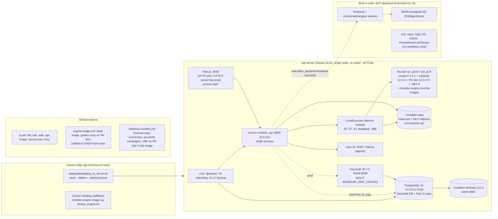

# F — Documentation, project history, known issues and deployment (post-MAP scope: S1–S7 and the package)

Audit slice F, read-only. Repository `/workspace/Modeler_One_AI` at HEAD `1dbda7f` (2026-11-25, "Merge slice 10 of the
console redesign", #185). The local clone is shallow (193 commits, earliest 2026-11-15), so commit history before
that date is known only from `CHANGELOG.md`.

Conventions in these notes:
- **[DOC]** is a claim a document makes. **[CODE]** is something I checked in the code.
- `file:line` points at the evidence. CHANGELOG line numbers refer to the heading or bullet quoted.
- I give environment variable names only, never their values.
- "Real PK-Sim" means the claim's source says it ran on `run_job.R` / `run_pi.R`: either the server's installation or
  the engine image on a GitHub runner. The stub and analytical engines never count (CLAUDE.md).

---

## 1. Summary

- **What is deployed:** one Linux server (`adt-server`, no sudo). It runs:
  - one `uvicorn` process (the FastAPI API, `0.0.0.0:8000`), which runs every campaign in-process on daemon threads
    (`LocalExecutor`);
  - the Next.js web app on `:3000`;
  - file-backed stores under `~/modeler-data`;
  - real PK-Sim from a conda R installation in `~/modeler-engine`, not from the qualified Docker image.

  Optional on the same server: Keycloak 26.7.5 (`:8443` HTTPS, `:8080` HTTP) and PostgreSQL 16 (`127.0.0.1:5432`).
  PostgreSQL holds only Keycloak's database and a copy of the Part 11 audit events and signatures.

  Built in code but **not deployed:** Temporal, MinIO with presigned URLs, the Temporal orchestrator and engine
  workers. Also never built: k3s, Helm, Argo CD and the observability stack (`deploy/server/_env.sh:52-62`,
  `run_modeler.sh:40-58`; no Kubernetes or Helm file anywhere in the repository).
- **Which mode the server runs in** depends on whether `MODELER_OIDC_ISSUER` is in the secrets file
  (`_env.sh:34-40`).
  - Pilot: the DEV verifier signs, so no signature is Part 11.
  - Production: Keycloak sign-in.

  The repository cannot say which mode is live now. The 2026-11-10/11 entries describe going live on Keycloak
  (CHANGELOG:5615, 5542). The 2026-11-25 deploy plan expects "Keycloak sign-in" (`docs/plans/2026-11-25-console-redesign-deploy.md:66`).
- **The post-MAP pipeline S0→S7** was built from 2026-09-16 to 2026-09-24. It was then deepened:
  - VPC, S6/S7 and the package (2026-09-24);
  - Lane B, the non-linear backend: SJ, feedback cycles, no-regression (2026-10-05);
  - VBE (2026-10-09);
  - run integrity R0 (2026-10-18);
  - D-35/D-36/D-37 (2026-10-19 → 22);
  - PI-1 → PI-4 B2b (2026-10-24 → 11-02).

  Since 2026-11-03 nearly all work is pre-MAP: intake, the Data room and the console redesign.
- **Real-PK-Sim evidence for the post-MAP stages** comes in three kinds:
  - **Known-truth (synthetic) campaigns pass every stage.** Aciclovir S0→S5 took 201 s, S0→S7 264–266 s
    (CHANGELOG:11416, 11397, 11406).
  - **Every published-model campaign on real clinical data stops at S1.** Dapagliflozin, Rifampicin, and the
    Itraconazole and Verapamil systems escalate at S1, mostly on a short IV infusion's Cmax with AUC in band. That is
    an open SME question (`docs/SME_SIGNOFF.md:20`).
  - **T-56 is the only campaign that reached S7 on the server on real (published) data.** It is
    `camp_bc05bdd4096748298bf2048921baae46`, run 2026-10-22: 9 min, no fit ran, in pilot. So it cannot be the
    production PQ evidence §4.3 calls it (CHANGELOG:7502-7518, 7444-7446).
  - The plan's exit criterion is not met: Dapagliflozin and Rifampicin S0→S7 on clinical data with GMFE at least as
    good as the published model (`docs/plans/2026-09-24-s0-s7-real-pbpk.md:148-160`).
- **The 1-hour goal (CLAUDE.md) conflicts with the signed default.**
  - The plan's default campaign budget is 8 h (`modeler_project/plan.py:81`).
  - MS-01's split leaves S3 4 min of a 1-h budget, under the 15-min fit reserve (CHANGELOG:8350-8353).
  - PQ-07 fails any campaign over 60 min (`validation_pack.py:78,119`).
  - The Verapamil system refit ran 12,045 s (3.3 h) and still escalated (CHANGELOG:8635).
  - This conflict is not in `docs/SME_SIGNOFF.md`.
- **Most surprising:**
  1. A campaign running when the API restarts is lost. Deploys and the watchdog restart it, and nothing recovers the
     campaign at startup. Data room runs, by contrast, resume (`modeler_api/main.py:44-55`,
     `local_runner.py:1153-1169`).
  2. The `rerun_all.R` shipped in every package is never executed by the S7 gate or by any test
     (`package_activities.py:294-307`; `test_reproducibility.py:161-162`).
  3. Two IQ checks cannot work as intended:
     - IQ-10 reads a `MODELER_WEB_TLS` variable that no script sets (`qualify.sh:14`, `qualify.py:180`);
     - IQ-05 compares a hash with itself (`_env.sh:61` vs `qualify.py:116-121`).
  4. `docs/CONTINUATION_PACKAGE.md` still says "758 Python tests". The CHANGELOG reports 3,308 passing on 2026-11-23
     (CONTINUATION:18 vs CHANGELOG:1406).

---

## 2. Deployment architecture: intended vs actual

### 2.1 Intended (documented, "FINALIZED")

- **[DOC] `docs/ENGINEERING_PLAN.md` §1, §8, §9** (v1.0, 2026-09-15) describes a control plane and an engine plane:
  - **Control plane:** Traefik, Keycloak, the FastAPI API, PostgreSQL 16 on CloudNativePG (one primary and two
    replicas), MinIO with Object Lock, self-hosted Temporal, orchestrator and agent workers, SSE to the browser.
  - **Engine plane:** engine workers on task queues `engine-s`, `engine-m` and `engine-l`, with presigned MinIO I/O and
    no egress.
  - **Runtime:** k3s on three on-prem Ubuntu 24.04 servers with `/data` disks, plus KEDA, Argo CD, SOPS,
    kube-prometheus-stack, Loki and Tempo (ENGINEERING_PLAN:38-62, 302-388).
  - Decision D9 restates it (CONTINUATION:61).
- **[DOC] `docs/ARCHITECTURE_PACK.md` §5** (DRAFT v0.2) adds three more pieces: a Windows qualification pool
  (Track B), pgvector, and Redis (ARCHITECTURE_PACK:492-543, 652-661, 725-732).
- **[DOC] Testing gates** (ENGINEERING_PLAN §13) expect three things: a compose integration stack, a Temporal
  time-skipping workflow test, and SSE and `Idempotency-Key` on every POST that creates something (ENGINEERING_PLAN:256-262).

### 2.2 Actually deployed (scripts in `deploy/server/`, `deploy/dev/`)

**[CODE] Processes**
- `run_modeler.sh` starts the stack:
  - PostgreSQL, when it is installed (`run_modeler.sh:33-35`);
  - Keycloak, when `MODELER_OIDC_ISSUER` is set (`:36-38`);
  - `nohup uv run uvicorn modeler_api.main:app --host 0.0.0.0 --port $API_PORT`, a single process with no
    `--workers` (`:40-45`);
  - the web, as `npm start` (HTTP) or as `node apps/web/server.mjs` when a TLS certificate is configured (`:47-58`).
- **Campaigns** run on a `threading.Thread(..., daemon=True)` inside the API process (`local_runner.py:1153-1169`).
- **Engine jobs** are `Rscript …/run_job.R` subprocesses, each started with `start_new_session=True`
  (`_env.sh:56`; `modeler_engine/runner.py:179`).
- **No Temporal worker** is started anywhere (`run_modeler.sh`). The Temporal workflow skips SJ, S6 and S7
  (`modeler_orchestrator/campaign.py:356-361`) and uses a 1800 s default per stage (`campaign.py:66`).

**[CODE] Ports**

| Port | Service | Bound to |
|---|---|---|
| 3000 | web (HTTP in pilot, HTTPS in production) | `0.0.0.0` (`run_modeler.sh:54`) |
| 8000 | API | `0.0.0.0` (`run_modeler.sh:42`); also reached through the web's `/api/*` proxy |
| 8443 | Keycloak HTTPS | default bind |
| 8080 | Keycloak HTTP back channel (JWKS, code exchange) | the comment says "on 127.0.0.1" (`keycloak.sh:22`), but `kc.sh start` is given no `--http-host` (`keycloak.sh:189-191`); **POTENTIAL** exposure on all interfaces |
| 5432 | PostgreSQL | `listen_addresses = '127.0.0.1'` (`postgres.sh:88-92`) |
| 4000 | LiteLLM proxy for the agents | `127.0.0.1`, as `_env.sh:67` describes it |

All defaults are from `_env.sh:9-10,41-42` and `keycloak.sh:35-36`.

**[CODE] Lifecycle (cron, no systemd, no sudo)**
- `install_autostart.sh` installs three entries (`:141-147`):
  - `@reboot sleep 30 && run_modeler.sh --watchdog`;
  - `*/5` the watchdog;
  - `02:17` `postgres.sh backup && restore-check && verify`.
- `stop_modeler.sh` sets the `.stopped` flag, which the watchdog honours (`:6`, `run_modeler.sh:18-23`). It also runs
  `pkill -f next-server` and `pkill -f apps/web/server.mjs` (`stop_modeler.sh:20-21`), which kill any such process of
  the user, not only this stack's.

**[CODE] Data directories**

| Path | Holds | Source |
|---|---|---|
| `~/Modeler_One_AI` | rsync target, not a git checkout; `.deployed.json` written per deploy; the server-only `server_e2e*.py` kept out of `--delete` | `deploy_to_server.sh:22-28` |
| `~/modeler-data/read-root` | every file-backed record: projects, CPFs, campaigns, escalations, stage evidence, packages | `_env.sh:12,54` |
| `~/modeler-data/objstore` | the `file://` object store | `_env.sh:55` |
| `~/modeler-data/{showcase,t56,qualification}` | seeder logs, the T-56 kit's output, IQ records | `seed_examples.sh:110`, `deploy/proof/README.md:24`, `qualify.py:209` |
| `~/modeler-logs` | `api.log`, `web.log`, `keycloak.log`, `postgres.log`, `autostart.log`, `backup.log`, `seed.log`, PID files | `_env.sh:7` |
| `~/modeler-engine` | conda R library (`rlib`) and .NET; Miniforge in `~/miniforge3` | `_env.sh:14-19`; CONTINUATION:776-778 |
| `~/modeler-postgres` | `{env,data,run,secrets}` | `postgres.sh:26-29` |
| `~/modeler-backups/<date>` | dumps kept 14 days, on the same disk by default | `postgres.sh:31-33,148-161` |
| `~/modeler-keycloak` | `{keycloak-26.7.5,jdk,tls}` | `keycloak.sh:31-34` |
| `~/.modeler-secrets.env` | site settings and secrets, chmod 600, outside the repository | `_env.sh:21-26` |

`~/modeler-data` (the read root and the object store) is **not backed up** by any script. The nightly job dumps only
the `keycloak` and `modeler` PostgreSQL databases (`postgres.sh:153-156`). In production, PostgreSQL holds only the
Part 11 copy; projects and campaigns stay in files (CONTINUATION:708-711).

**[CODE] Engine identity**
- The server does not run the image. `MODELER_IMAGE_DIGEST` is computed as `catalog:sha256:<hash of golden/catalog.json>`
  (`_env.sh:57-61`).
- `MODELER_ENGINE_ID` defaults to the constant `ospsuite-12.4.4` for any command naming `run_job.R`
  (`runtime.py:59,79-85`).
- The catalog was harvested on the server's conda R, platform `x86_64-conda-linux-gnu`, on 2026-09-15 (`golden/catalog.json:2-10`).
- The qualified image is a different build: `rocker/r-ver:4.6.1`, base not pinned by digest, ospsuite from a commit
  with a sha256 check, PI 2.2.0 tree-hashed, rSharp 1.2.2 with no checksum, .NET from `dotnet-install.sh --channel 8.0`
  (`services/engine-worker/Dockerfile:12-77`). Its last recorded publication by digest was 2026-10-08 (CONTINUATION:724).
- Most recorded PK-Sim evidence since 2026-10-09 comes from the image on GitHub runners. Server evidence is limited to
  2026-09-24 and the T-56 runs (section 4).

**[CODE] Deploy path**
- `deploy_to_server.sh` runs from the Mac:
  - it warns, but does not refuse, when the branch is not a clean `main` (`:18-20`);
  - it rsyncs with `--delete` and writes `.deployed.json`;
  - then, on the server: `uv sync`, `npm ci && npm run build`, `stop_modeler.sh`, `run_modeler.sh`, `status_modeler.sh`
    (`:30-39`).
- The stop step kills any campaign thread that is running (see §7, D1).

**[CODE] Other deploy files**
- `docker-compose.yml` is local development only: postgres, minio, temporal `start-dev`, keycloak `26.0`, api, and
  engine-worker under profile `engine`.
  - It has no orchestrator worker, and its images use `:latest` tags.
  - Its header says "production runs on Kubernetes via Helm" (`docker-compose.yml:1`), but no Helm chart exists.
  - Its `api` service sets `MODELER_TEMPORAL_ADDRESS` but not `MODELER_EXECUTION_BACKEND`, so it would still run the
    local executor (`config.py:21`, `campaign_api.py:64`).
- `services/api/Dockerfile` builds from `mirror.gcr.io/library/python:3.12-slim` and runs uvicorn as UID 10001. No
  deploy script uses it on the server.
- `deploy/showcase/seed_examples.py` creates projects through the API with the DEV token, using
  `MODELER_SEED_TOKEN` or a development default. It signs each MAP via `POST /projects/{pid}/signatures`
  (`seed_examples.py:37,160-163`), so it only works in pilot.
- `deploy/reference/run_all.sh` reads the task matrix from `.github/workflows/reference-models.yml`. That workflow runs
  only on `workflow_dispatch` (`reference-models.yml:15-16`).
- Reference campaigns run unsigned development MAPs and stop at the S6 signature gate (`run_reference.py:20-22`).

### 2.3 Deployment diagram (actual vs intended)

---

## 3. Configuration: `MODELER_*` variable names relevant to the scope

Names only; no value is given. "Set by" names the script that exports the variable on the server.

| Variable | Controls | Where read | Set by (server) |
|---|---|---|---|
| `MODELER_DEPLOYMENT` | `development`, `pilot` or `production`. Pilot and production refuse to start without an object store, an engine command and a real digest; production also refuses the DEV verifier and needs Part 11 records in PostgreSQL | `runtime.py:52-53,113-140`; `config.py:64-85` | `_env.sh:34-40` |
| `MODELER_DEV_AUTH` | DEV verifier: any bearer becomes a fixed principal with a fresh loa2 step-up | `config.py:38-40`; `auth.py:90-112` | `_env.sh:39` (pilot) |
| `MODELER_OIDC_ISSUER`, `MODELER_OIDC_JWKS_URL`, `MODELER_OIDC_BACKCHANNEL`, `MODELER_OIDC_CLIENT_ID`, `MODELER_WEB_URL` | Keycloak sign-in; the presence of the issuer switches the server to production | `config.py:30-33`; web `lib/oidc.ts` | `keycloak.sh env` (`:237-251`) into the secrets file |
| `MODELER_EXECUTION_BACKEND` | `local` (in-process `LocalExecutor`) or `temporal` | `config.py:19-21`; `campaign_api.py:64` | `_env.sh:53` (local) |
| `MODELER_TEMPORAL_ADDRESS`, `MODELER_TEMPORAL_NAMESPACE` | Temporal client for campaign start and signals | `campaign_api.py:65-71`; `escalations.py:87-93` | not set |
| `MODELER_READ_ROOT` | root of every file-backed record, the campaign monitor and evidence included | `config.py:26`; `runtime.py:31` | `_env.sh:54` |
| `MODELER_OBJECT_STORE_URI` | object store (`file://` on the server) | `runtime.py:32`; `config.py:24` | `_env.sh:55` |
| `MODELER_S3_ENDPOINT`, `MODELER_S3_ACCESS_KEY`, `MODELER_S3_SECRET_KEY`, `MODELER_S3_BUCKET`, `MODELER_S3_REGION` | MinIO/S3 store and presigning (unused on the server) | `runtime.py:44-48`; `modeler_storage/objects.py:44-90` | not set |
| `MODELER_ENGINE_COMMAND` | the engine executable: `run_job.R`, `docker_engine.sh`, or a fixture. Decides the kind `pksim` vs `software-fixture` | `runtime.py:33,66-85` | `_env.sh:56` |
| `MODELER_ENGINE_ID` | the engine id recorded on runs; default from the command | `runtime.py:34,79-85` | not set (so the constant `ospsuite-12.4.4`) |
| `MODELER_IMAGE_DIGEST` | engine digest stamped on MAPs and runs; must match `(catalog:)?sha256:<64 hex>` | `runtime.py:35,129-138`; `config.py:44-46` | `_env.sh:61` (hash of the catalog) |
| `MODELER_ENGINE_CATALOG` | catalog file used to compute the digest (shell variable) | `_env.sh:60` | `_env.sh` |
| `MODELER_ENGINE_IMAGE` | image tag for `docker_engine.sh` (Mac fallback) | `docker_engine.sh:19` | Mac only |
| `MODELER_FIT_WORKERS` | parallel fit starts per fit, overriding the planner | `local_runner.py:145-153`; `run_all.sh:31` | not set on the API (reference runs set it) |
| `MODELER_ENGINE_CORES`, `MODELER_ENGINE_CONCURRENCY`, `MODELER_RESOURCE_CLASS` | engine-worker sizing (Temporal worker) | `runtime.py:36-38`; `modeler_engine/worker.py:55` | not set |
| `MODELER_MEMO` | memoised engine runs (S7 re-runs exempt) | `runtime.py:40` | not set |
| `MODELER_PART11_STORE`, `MODELER_DATABASE_URL` | Part 11 audit and signature copy in PostgreSQL (required in production) | `config.py:34-37,75-85` | `postgres.sh env` (`:188-195`) into the secrets file |
| `MODELER_KEYCLOAK_*` (`HOST`, `CERT`, `KEY`, `HOME`, `HTTP_PORT`, `HTTPS_PORT`, `DB`) | Keycloak install and start | `keycloak.sh:13-19` | secrets file |
| `MODELER_POSTGRES_*` (`HOME`, `PORT`, `BIN`), `MODELER_BACKUP_DIR` | PostgreSQL and backups | `postgres.sh:16-18` | defaults |
| `MODELER_WEB_TLS_PFX`, `MODELER_WEB_TLS_PFX_PASSFILE`, `MODELER_WEB_TLS_CERT`, `MODELER_WEB_TLS_KEY` | HTTPS for the web | `_env.sh:46`; `apps/web/server.mjs` | `keycloak.sh env` |
| `MODELER_WEB_TLS` | IQ-10's HTTPS switch; **never set by any script** (see §7, D4) | `qualify.sh:14`; `qualify.py:180` | — |
| `MODELER_API_PORT`, `MODELER_WEB_PORT`, `MODELER_API_BASE`, `MODELER_REPO`, `MODELER_DATA`, `MODELER_LOGS`, `MODELER_SECRETS_FILE` | ports and paths | `_env.sh:5-10,25,62` | defaults |
| `MODELER_SERVER` | ssh target for `deploy_to_server.sh` | `deploy_to_server.sh:10` | Mac |
| `MODELER_SEED_TOKEN`, `MODELER_SEED_MIN_FREE_GB` | showcase seeder's bearer and disk guard | `seed_examples.py:37`; `seed_examples.sh:103` | defaults |
| `MODELER_LLM_*` (`PROVIDER`, `MODEL`, `TIMEOUT_S`, `FALLBACK`, `EFFORT`, `STREAM`), `MODELER_MASTER_KEY` | agents (mostly pre-MAP; A6 feedback proposals not built) | `_env.sh:64-72`; `config.py:49-52` | secrets file |

Known gap, recorded and then closed: "one variable, several defaults". It was recorded at CHANGELOG:9972-9975 and
closed by the 2026-10-08 decision (CHANGELOG:9729-9730). After that, `runtime.py` is the single reader for the
orchestrator and engine, and `config.py` for the API.

---

## 4. Timeline of post-MAP development and of the real-PK-Sim evidence

### 4.1 Development timeline (from `CHANGELOG.md`; hashes as recorded there)

| Date | What | Source |
|---|---|---|
| 2026-09-15 | Engine verified on the Linux server (T-01). Benchmark: 0.506 s per run, 47-core batch 0.00555 s/run, PI 0.36 s per evaluation. Catalog harvested (T-02) | CONTINUATION:776-801 |
| 2026-09-16 | Repository under git. Temporal campaign workflows (T-13), persistence with RLS (T-05), object store (T-07), results ingestion (T-08), cancellation (T-09), MAP generator (T-16) | CHANGELOG:11565-11574 |
| 2026-09-17 | Round loop wired. Diagnostics ruleset (T-14), strategist (T-15), NCA (T-18). `ValueOrigin.Source` enum defect fixed: PK-Sim had silently dropped every simulation | CHANGELOG:11552-11563 |
| 2026-09-18 | Fit loop end to end; PI recovered GFR fraction 1.0 from 0.4 on the engine. Escalations, deviations and decisions API (T-17); bundle and reproducibility gate (T-23); Keycloak OIDC (T-06) | CHANGELOG:11539-11550 |
| 2026-09-19 | `LocalExecutor` and file stores (`MODELER_EXECUTION_BACKEND`). MAR (T-24), `rerun_all.R` "byte-exact reproduction verified on the engine" (T-23), validation pack (T-32) | CHANGELOG:11523-11537 |
| 2026-09-24 | Diagnosis that every campaign stopped at S1: roadblocks R1–R13, `CHANGELOG.md`, CLAUDE.md | `docs/plans/2026-09-24-s0-s7-real-pbpk.md:35-51`; CHANGELOG:11457-11471 |
| 2026-09-24 | R1/R2: S4/S5 simulate in validation mode. R13: post-fit re-simulation. Unit conversion, multiple dose | CHANGELOG:11284-11325 |
| 2026-09-24 | R4: expression profiles harvested; before this, enzyme-cleared drugs had zero metabolism. Transporter direction key fixed | CHANGELOG:11327-11344 |
| 2026-09-24 | R5: Weibull tablets and the S3 formulation sub-loop. A base-unit defect in every fit fixed (permeability was stored 10× too low). Parallel fit starts | CHANGELOG:11346-11372 |
| 2026-09-24 | R8/R9: S6 (sensitivity, 200-draw uncertainty) and S7 (bundle, 1e-6 re-run, MAR DOCX and PDF/A, package only if reproduced). Signature gate before S6. Package API | CHANGELOG:11374-11407 |
| 2026-09-24 | R7: VPC gate (n = 100, at least 80 % inside 5–95 %) at S1/S2, reported at S4. R6: diag-rules 0.2, renal rule | CHANGELOG:11421-11444 |
| 2026-09-24 → 25 | Phase 4: reference importer (OSP snapshot → CPF and real studies); reference runs on Actions; 12 published models in the wizard | CHANGELOG:10633, 10622, 10195 |
| 2026-10-05 | Lane B, T-51 → T-55: model sets, memoised runs, no-regression gate, SJ (MS-01 v1.1), feedback cycles (MS-01 v1.2), change ledger. Software only | CHANGELOG:11002, 10969, 10906; CONTINUATION:690 |
| 2026-10-06 | Atomic writes; first campaign record written before the id is returned. Known gaps on unlocked read-modify-write recorded | CHANGELOG:10035-10052 |
| 2026-10-07 → 09 | Architecture refactor phases 1–9; locked-files list. Reference checks move to the server; Actions reference workflow made manual | CHANGELOG:10054-10058 |
| 2026-10-09 | MS-01 v1.3 with stage SM (D-25); EHC placement; Weibull equation confirmed on PK-Sim; VBE (T-31 B6, D-26); pilot deployment | CHANGELOG:8922, 9006, 8822-8672, 9117 |
| 2026-10-13 → 15 | Keycloak K1–K3, PostgreSQL P1, Part 11 copy P2, members P3 (PRs #60–#65) | CHANGELOG:8566-8404 |
| 2026-10-18 | R0 run integrity: stage limits from the signed MAP, no unsigned start outside development, model risk never assumed, default budget 8 h | CHANGELOG:8292-8357 |
| 2026-10-19 → 20 | R4b/R4d: estimation plan, fit bounds signed in the MAP (D-34/D-35/D-36) | CHANGELOG:7761, 7693 |
| 2026-10-22 | D-37: the diagnosis may fit MS-01 candidates within their default bounds. Validation pack IQ/PQ. T-56 run on the server | CHANGELOG:7462, 7423, 7502 |
| 2026-10-23 | T-56 re-run escalated at S1 after 5 s. Fix: stage notes say whether and why a fit ran | CHANGELOG:7401-7421 |
| 2026-10-24 → 29 | PI-1 (pin PI 2.2.0), PI-2 (correlations and CI), PI-3 (stay linear), PI-2b (`fix_and_refit`) | CHANGELOG:7348, 7305, 7286, 7233 |
| 2026-11-02 | Log-scale review; MAP carries the M15 assessment (#117); PI-4 B1 (group factor and log scale in `run_pi.R`), B1b, B2a, B2b; grouped refit on PK-Sim | CHANGELOG:6911, 6860, 6792, 6766, 6731, 6709, 6697 |
| 2026-11-10 → 11 | Going live on Keycloak under the Tailscale name; `tailscale cert` fix | CHANGELOG:5615, 5542 |
| 2026-11-13 | D1b: `run_pi.R` labels a geometric SD. Its merge was later "found … with its conditions unticked" | CHANGELOG:5187; 11604 |
| 2026-11-23 → 25 | Security fixes R-S01/03/04. Console redesign slices 1–10: campaign page in tabs with a Package tab (slice 6); engine check on System status (slice 8); deploy plan (slice 10) | CHANGELOG:1498, 937, 871, 16 |

### 4.2 Roadblocks R1–R13: status reconstructed

The plan has no status column (`2026-09-24-s0-s7-real-pbpk.md:37-51`). The status below is inferred from the
CHANGELOG.

| # | Status | Evidence |
|---|---|---|
| R1 S4/S5 never simulate | Fixed | CHANGELOG:11284-11285 |
| R2 no validation mode | Fixed | CHANGELOG:11287-11288 |
| R3 MD/MR/special populations unused | Partial. MD simulated; MR and other external classes in S5. DDI, PGX and special populations only named, because no S6 templates exist | CHANGELOG:11285-11286; CONTINUATION:738 |
| R4 no metabolism on PK-Sim | Fixed | CHANGELOG:11327-11344 |
| R5 tablets, S3 | Partial. Weibull and the S3 release fit built; fed sub-loop missing (`food.fed_solubility_factor` has no registry binding) | CONTINUATION:671; [CODE] the id appears in `map.py:56` and `diag_rules.yaml:200`, but not in `parameters/registry.yaml` |
| R6 renal clearance rule | Fixed in diag-rules 0.2 (now 0.6), UNVERIFIED | CHANGELOG:11439-11444 |
| R7 VPC | Fixed | CHANGELOG:11421-11432 |
| R8 S6 | Partial. Sensitivity and independent draws work; correlations not propagated (PI-8); templates other than VBE missing | CHANGELOG:11379-11382; PI review:79 |
| R9 S7 | Partial. Package and MAR work; no MAR signature flow | CONTINUATION:676 |
| R10 engine availability | Partial. Autostart since 2026-09-24; Tailscale apparently in use by 2026-11-11; the root disk reported 95 % full and never shown to be resolved | CHANGELOG:5542; CONTINUATION:46 |
| R11 the stand-in was not PBPK | Fixed. Fixtures are labelled "Not a PBPK result" | `USING_THE_TOOL.md:3-5` |
| R12 documentation debt | Recurring. See §6 | — |
| R13 fit credited a round late | Fixed | CHANGELOG:11297-11300 |

### 4.3 Real-PK-Sim evidence for the post-MAP pipeline (campaigns and fits)

| Date | Run or campaign | Engine host | What | Result | Wall time vs 1 h | Source |
|---|---|---|---|---|---|---|
| 2026-09-18 | fit smoke | engine | PI on GFR fraction from 0.4 | recovered 1.0 | — | CHANGELOG:11542-11544 |
| 2026-09-24 | Aciclovir, wrong GFR fraction (0.4), illustrative IV profile | image under Docker on the Mac | S0→S5 | S1 fit to GFR fraction 1.272 (AUC 2.06× → 1.008×); S2/S3 skipped; S4 pass; S5 "not achievable" | not stated | CHANGELOG:11284-11288 |
| 2026-09-24 | known-truth Aciclovir (IV, oral, Weibull tablet), high risk | server | S0→S5 | permeability and t50 recovered exactly; S4 VPC 100 %; S5 4 external pass | **201 s** | CHANGELOG:11413-11419 |
| 2026-09-24 | known-truth | server | S0→S7 | S6 sensitivity ranking; S7 reproduced 7/7 tables; 147-file package | **264 s** | CHANGELOG:11396-11399 |
| 2026-09-24 | known-truth in the live tool | server | S0→S7 with downloads | PDF/A-2b, DOCX, 152-entry zip | **266 s** | CHANGELOG:11405-11407 |
| 2026-09-24/25 | first reference runs | GitHub runner, image | Dapagliflozin as-is, refit | as-is S1 escalated on IV Cmax 0.48× (evaluation defect, fixed); refit S1 `BudgetTooSmallError` (1800 s stage, 4-core runner) | — | CHANGELOG:10561-10571 |
| 2026-09-25 | 36079717728 | image | as-is and refit baseline | the same four S1 escalations as below | — | CHANGELOG:8898-8899 |
| 2026-10-09 | reference 37922984864 | image | Dapagliflozin and Rifampicin, as-is and refit; round trips | Dapagliflozin as-is S1 IV Cmax 0.52×; Rifampicin as-is S1 IV Cmax 1.59×; Rifampicin refit S1 VPC 3/6; Dapagliflozin refit S1 UGT1A9 at bound. Round trips: Dapagliflozin 25/34 within 1e-6, Rifampicin 21/22 | — | CHANGELOG:8897-8920 |
| 2026-10-09 | engine-image 37919482630 | image | Weibull release equation | max deviation 4.2e-05 of the dose | — | `docs/SME_SIGNOFF.md:54` |
| 2026-10-09 | reference 37947587365 | image | Itraconazole and Verapamil systems, as-is | both escalate at S1 before SM: IV Cmax 2.14× and 3.10× | — | CHANGELOG:8619-8628 |
| 2026-10-09 | reference 37951203929 | image | Verapamil system refit | S1 escalates: formation kcats at lower bounds, racemic-sum AUC 0.46× | **12,045 s (3.3 h)**, over the goal | CHANGELOG:8635-8642 |
| 2026-10-09 | engine-image 37958733969 | image | engine occasion (VBE) | golden case passes | — | CHANGELOG:8631-8633 |
| 2026-10-09 | reference 37965688096 | image | illustrative VBE (Dapagliflozin, invented TEST) | AUC GMR 0.979, Cmax 0.880, PoS 100 %, NOT_VALIDATED | **156 s** | CHANGELOG:8661-8666 |
| 2026-10-18 | Actions 39131983498 and 39132704379 | image | R0 regression | Dapagliflozin results unchanged; S3 2-round limit not exercised (nothing reaches S3) | — | CHANGELOG:8333-8343 |
| ~2026-10-20 | Actions 39286267822 | image | refit after R4d | identical; S1 GMFE 2.478/2.516 → 1.412/2.291 | — | CHANGELOG:7733-7735 |
| **2026-10-22** | **T-56 `camp_bc05bdd4096748298bf2048921baae46`** | **server** (`Rscript run_job.R`), **pilot** | P0 → P6 from a mock proposal, published values, 40 judged studies | trace complete (42 parameters, 40 studies, 17 MAR entries); MAR reproduced. **No fit ran** (before D-37). S1 IV Cmax 0.54× | **9 min**. The "60-min budget" was a display placeholder; the signed budget was 8 h | CHANGELOG:7502-7518, 7418-7420; PI review:19-20, 49 |
| 2026-10-23 | T-56 re-run `camp_5a30f5fda3c547f18b597d6e7a08040c` | server | — | escalated at S1 after 5 s; logP fit never tried, most likely because the plan was signed before D-37 (unconfirmed) | 5 s, then stopped | CHANGELOG:7401-7410 |
| 2026-10-24 | engine-image 40079660726 and 40080162775 | image | PI-2 golden | correlation exported (r = 0.42); the log-scale subclass failed (−0.30 1/min) | — | CHANGELOG:7331-7343 |
| 2026-10-25 → 27 | Actions 40206672048 and 40739239767 | image | refit before and after PI-2b | the same: UGT1A9 at lower bound, UGT2B7 at upper; every CI wider than its estimate; 59 % of starts agree | — | CHANGELOG:7272-7285 |
| 2026-11-02 | engine-image 41467498164 | image | B1 golden (Aciclovir GFR plus tubular secretion) | factor 0.5008 (truth 0.5) linear and log | — | `2026-11-02-pi-4b-relative-group.md:200-206` |
| 2026-11-02 | reference 41495102951 | image | Dapagliflozin refit grouped vs ungrouped (32 starts) | grouped factor 0.4565 (CI 0.31–0.672), 100 % agreement; ungrouped 67-fold apart. **Both escalate at S1** on IV Cmax | not stated | `2026-11-02-pi-4b-relative-group.md:224-242`; CHANGELOG:6697-6707 |

**What this shows:**
- No published-model campaign on clinical data has passed S1 without a person's decision.
- S2–S5 have passed on PK-Sim only with synthetic known-truth data.
- T-56 reached S7 on real data only because no fit was possible, and its S1 outcome must have been decided by a person.
  The stage verdicts "are in its MAR, not in the trace" (CHANGELOG:7517).
- No recorded server campaign has run after D-37, PI-2b or PI-4 B. PI-0, "re-run T-56 with a plan signed after D-37",
  is still open (PI review:69, 100).
- CONTINUATION:619 says to "rebuild the server's engine image" with B1. The server runs no image: `run_pi.R` reaches
  it by rsync (`_env.sh:56-59`).

---

## 5. Open items, roadblocks, known limitations and SME questions (S1–S7 and the package)

| Item | Stage | Status | Source |
|---|---|---|---|
| S1 judges a short IV infusion's Cmax: published Dapagliflozin (0.52×), Itraconazole (2.14×) and Verapamil (3.10×) escalate with AUC in band | S1 | open, SME | `SME_SIGNOFF.md:20`; PI review F7:49 |
| Clinical-data proof: Dapagliflozin and Rifampicin S0→S7 with GMFE at least the published model's (plan exit) | S1–S7 | not met | s0-s7 plan:148-160; CONTINUATION:669-676 |
| PI-0: re-run T-56 with a plan signed after D-37 | S1–S3 | open (owner, server) | PI review:69,100 |
| D-37 default bounds (six-decade clearance range) decide real fits | S1–S3 | UNVERIFIED, no PK-Sim evidence | CHANGELOG:7497-7500; `SME_SIGNOFF.md:36` |
| PI-4 B3: the rule that proposes a fit group | S1–S3 | waits for the SME; **not in `SME_SIGNOFF.md`** | pi-4b plan:166-170,246; [CODE] no "group" in `SME_SIGNOFF.md` |
| PI-5 (choose by sensitivity), PI-6 (fit clearance and distribution together), PI-7 (verify the error model, SD weighting and BLQ), PI-8 (covariance in S6) | S1–S3, S6 | not started | PI review:76-79 |
| SD weighting does not enter the objective: PI 2.2.0's default weighting is "none" and `run_pi.R` sets none | S1–S3 | open, SME | CHANGELOG:4893, 5154, 5207-5210; [CODE] no `objectiveFunctionOptions` in `run_pi.R` |
| D1b: geometric SD labelling has not run on PK-Sim; merged with its conditions unticked | S1–S3 | open evidence | CHANGELOG:5187-5243, 11604 |
| Near-1 log values: the Hessian step shrinks | S1–S3 | known gap (package rule) | CHANGELOG:6831-6833 |
| Rifampicin refit: VPC 3/6 at S1 | S1 | open science | CHANGELOG:8907, 8918-8919 |
| Verapamil system refit: co-parent parameters not S1 candidates for a racemic sum | S1/SM | SME question | `SME_SIGNOFF.md:75-78`; CHANGELOG:8635-8642 |
| S3 fed sub-loop: no binding for `food.fed_solubility_factor`; MS-01 amendment needed | S3 | open (owner, SME) | CONTINUATION:671; remaining-to-goal:35 |
| S3 2-round limit never exercised on PK-Sim | S3 | open evidence | CHANGELOG:8344-8346 |
| SM proof on PK-Sim (systems stop at S1) | SM | open | CONTINUATION:672 |
| SJ and feedback cycles: PK-Sim acceptance; Temporal parity; A6 proposals | SJ/S5 | not done | CONTINUATION:690, 740; CHANGELOG:10938-10941, 10986-10988 |
| Fed studies at S5 wait on the S3 fed sub-loop | S5 | open | CONTINUATION:674 |
| DDI, paediatric, special-population and FIH templates; `ddi-cyp3a4-victim.yaml` is DRAFT with no runner | S6 | not started | CONTINUATION:738; `SME_SIGNOFF.md:48` |
| A real VBE with an observed BE study; which parameters carry intra-subject variability; NTI limits | S6 | open, SME | `SME_SIGNOFF.md:47,79-83`; ARCHITECTURE_PACK Q7:952 |
| S6 parameter correlations not propagated | S6 | open (PI-8) | CHANGELOG:11382 |
| MAR signature (author, reviewer, QA) | S7 | not built | CONTINUATION:676 |
| `.pksim5` in the package "not yet run in a campaign on the server" | S7 | open evidence | CONTINUATION:676 |
| No pilot or not-Part-11 mark in the MAR (deviation recorded 2026-10-09; [CODE] `campaign_mar.py` has no deployment reference) | S7 | open | CHANGELOG:9132-9133 |
| Temporal path: no SJ, S6 or S7; fixed 30-min stages; password-in-body signing (R-S06) | all | built, not deployed; R-S06 before any Temporal deployment | `campaign.py:66,356-361`; CHANGELOG:8354-8355, 5611-5613; deploy plan:112-113 |
| 1-hour goal vs MS-01 fractions (S3 4 min < 15-min reserve; a fitting S3 needs a budget over 3.6 h) | S0/S3 | owner/SME; **not in `SME_SIGNOFF.md`** | CHANGELOG:8350-8353; CONTINUATION:668 |
| Validation pack IQ/PQ "not yet run on the server"; URS v2 DRAFT for QA | package / GxP | open | CONTINUATION:732 |
| T-30: SME sign-off of every ruleset (acceptance 2026.2-draft, diag-rules 0.6, MS-01 1.3, registry 1.2, templates) | all | pending (human) | `SME_SIGNOFF.md:15-48`; [CODE] versions match the files |
| Acceptance ruleset literature findings (`guest_2011` title; 1.5-fold limit attributed to EMA) | all | open, SME (2026-11-24) | `SME_SIGNOFF.md:20` |
| T-29 Helm/k3s and observability; T-22 MCP; T-19, T-21 | infra | not started | CONTINUATION:735 |
| Live status without polling (R-N06); campaign Runs tab; platform audit page (R-N07) | UI for S1–S7 | not built | deploy plan:110-111 |
| Owner's acceptance by use (A5 run a campaign, A6 decide, A7 package) and the deploy go-ahead | UI / deploy | pending | deploy plan:3-5, 87-104 |
| Server root disk 95 % full; no data disk; no retention policy | infra | open | CONTINUATION:46; s0-s7 plan:48,81; [CODE] no retention or disk guard in `deploy/` or the orchestrator |
| Rifampicin MM kcat fit (known gap 2026-09-24) | S1 | closed by diag-rules 0.4 | CHANGELOG:10629-10631, 9101 |

---

## 6. Documents versus code, and stale documents

| # | Document says | Code or another source says | Verdict |
|---|---|---|---|
| S1 | "758 Python tests (730 pass…)" (CONTINUATION:18) | "pytest 3308 passed, 15 failed" on 2026-11-23 (CHANGELOG:1406). [CODE] 2,337 `def test_` functions in 249 files | stale |
| S2 | "Last brought up to date: 2026-11-19" (CONTINUATION:5) | §4's heading is "(2026-11-24)" (:214) and §4.0e covers 11-22 → 25 (:216) | internally inconsistent |
| S3 | "Active plans (2026-10-05)… Active plan: `2026-09-24-s0-s7-real-pbpk.md`" (CONTINUATION:31-34) | CLAUDE.md: the active plan is the newest in `docs/plans/`, which is `2026-11-25-console-redesign-deploy.md` | stale |
| S4 | Server "has no Tailscale yet" (CONTINUATION:46); Tailscale "awaiting the owner's login" (:715) | `tailscale cert` run on adt-server while going live, 2026-11-11 (CHANGELOG:5542-5545) | stale |
| S5 | "Object store: MinIO presigned I/O — not built" (CONTINUATION:713) | [CODE] `S3ObjectStore` with `presign_get`/`presign_put` (`modeler_storage/objects.py:44-90`); T-07 "Done" in §4.3 (CONTINUATION:723) | contradiction (built, not deployed) |
| S6 | T-16 "Done — but the MAP never schedules S4/S5 work (R1)" (CONTINUATION:731) | R1 fixed 2026-09-24 (CHANGELOG:11284-11286) | stale |
| S7 | T-23/T-24/T-32 "Done as libraries — not wired into campaigns (R9)" (CONTINUATION:732) | S7 wired in campaigns since 2026-09-24 (CHANGELOG:11374-11407) | stale |
| S8 | §4.1 S7 row lists "M15 influence/consequence capture" as missing (CONTINUATION:676) | #117: the MAP carries the M15 assessment and the MAR table reads it (CONTINUATION:649-650; [CODE] `campaign_mar.py:152-174`) | stale |
| S9 | §4.1 P5 row still lists the linear-on-log fit as missing (CONTINUATION:689) | Resolved by B1/B1b (CONTINUATION:606, 617-619; log-scale review:3-5) | stale |
| S10 | "Rebuild the server's engine image with B1" (CONTINUATION:619) | The server runs PK-Sim from `~/modeler-engine`, not the image (`_env.sh:57-59`) | misleading |
| S11 | "Going live… 1. Merge #60 → … #65" (CONTINUATION:762) | §4.3 says these were merged in order (CONTINUATION:742) | stale |
| S12 | T-56 "took 9 min of its 60-min budget. It is the PQ evidence" (CONTINUATION:744; CHANGELOG:7514-7518) | The "60-min" was a display placeholder; the signed budget was 8 h (CHANGELOG:7418-7420). PQ requires production; the 10-22 run predates the deployment record, so its PQ is INCOMPLETE (CHANGELOG:7440-7444), and it ran in pilot | overstated |
| S13 | Registry "`parameters/registry.yaml` 1.1" (CONTINUATION:741) | [CODE] `registry.yaml:46` version "1.2"; `SME_SIGNOFF.md:24` says 1.2 | stale |
| S14 | "Reference models (PK-Sim)… runs on every push" (USING_THE_TOOL.md:132-136) | [CODE] `workflow_dispatch` only (`reference-models.yml:15-16`); CHANGELOG:10054-10058 | stale |
| S15 | Seeder and T-56 kit: decide escalations "in the review inbox" (`seed_examples.py:16-18`; `deploy/proof/README.md:39-40`) | The review inbox was removed 2026-11-11 (CHANGELOG:5412); USING_THE_TOOL:39-42 now says Your work | stale |
| S16 | remaining-to-goal: "`git pull` on `main-1czavz`" (`2026-09-24-remaining-to-goal.md:51`) | CLAUDE.md: `main` is the only integration branch | stale |
| S17 | PI-4 options plan: "Status: DRAFT… Nothing is built" (`2026-10-29-pi-4-parallel-pathways.md:3`) | B1, B1b, B2a and B2b are built (pi-4b plan:197-245) | stale |
| S18 | `WORKFLOW_AND_AUTOMATION.md` v0.2: each start runs "with log residuals, SD weighting and LLOQ handling" (:105) | SD weighting is "none" in PI 2.2.0 and `run_pi.R` sets no weighting (CHANGELOG:5207-5210) | wrong; never updated since 2026-09-15 |
| S19 | `WORKFLOW_AND_AUTOMATION.md` §6: "Seconds per simulation on the Xeon is not measured yet"; disk 93 % (:194-204) | Measured 2026-09-15 at 0.506 s (CONTINUATION:779); disk 95 % (:46) | stale |
| S20 | `WORKFLOW_AND_AUTOMATION.md` §5 and ENGINEERING_PLAN §4.6: the gate re-runs `rerun_all.R` in a fresh pod or clean environment (ENGINEERING_PLAN:134-140) | [CODE] S7 re-runs each snapshot as a new `simulate` job on the same engine command (`package_activities.py:294-307`); `rerun_all.R` is only text-checked in tests (`test_reproducibility.py:161-162`) | mechanism differs |
| S21 | ENGINEERING_PLAN §7 "FINALIZED": SSE `/campaigns/{id}/events`, `Idempotency-Key`, `/questions/{id}/campaigns`, `/bundles`, `/evaluations/{id}`, `map:generate` | [CODE] `docs/api/openapi.json`: `POST /projects/{pid}/campaigns`, `campaign:prepare`, `/campaigns/{id}/package[/artifact]`, `escalation:resolve` / `:decide`, `deviations`. No SSE and no `Idempotency-Key` anywhere in `services/api/src`; `map:generate` retired in slice 9 (CHANGELOG:305) | doc not followed |
| S22 | ENGINEERING_PLAN §8.4: disk guard (< 2 GiB refuse), §9.1 campaigns refuse below 10 % free | [CODE] no disk check in the orchestrator or engine (only the seeder's 5 GB guard, `seed_examples.sh:101-106`) | not built |
| S23 | ENGINEERING_PLAN §6: "`tenant_id` … never from headers"; ARCHITECTURE_PACK §5.10 `POST /signatures {… password, otp}` | [CODE] the Temporal-path routes take `x_tenant_id` from a header and `password`/`second_factor` in the body (`escalations.py:100-118,139-147`). CLAUDE.md forbids passwords in requests. Inert: `get_verifier` always answers 503 (`escalations.py:83-84`) | contradiction (R-S06) |
| S24 | `docker-compose.yml:1` "production runs on Kubernetes via Helm"; ENGINEERING_PLAN §9 k3s | No Helm or k8s manifests in the repository; T-29 not started (CONTINUATION:735) | not built |
| S25 | D2 / Dockerfile comment: base "pinned by digest" (CONTINUATION:54; `Dockerfile:10`) | [CODE] `FROM rocker/r-ver:${R_VERSION}` with no digest (`Dockerfile:12-13`); a recorded known gap (CHANGELOG:8616-8617) | not done |
| S26 | `DevVerifier` docstring: "must never be used outside local development" (`auth.py:95`) | The server's pilot mode turns it on (`_env.sh:38-39`, owner's decision of 2026-10-09, CHANGELOG:9117-9127) with the API on `0.0.0.0` | policy conflict |
| S27 | `SME_SIGNOFF.md` "Last brought up to date: 2026-10-29" (:13) | It carries 2026-11-24 rows (:20, :40) but lacks PI-4 B3/fit groups, the log scale, PI-5 to PI-8, the 1-hour/fractions question and the S3 fed amendment | partly stale and incomplete |
| S28 | `docs/SESSION_HANDOFF.md` marked superseded (:1-4) | correctly marked | OK |
| S29 | Counts of OSP models: "25 public JSON snapshots… 22 import S0-ready" (CONTINUATION:727) vs "22 of 24 importable in the library" (remaining-to-goal:17) | — | inconsistent counts |
| S30 | The sessions table ends with a 2026-11-24 "optimistic-feynman" row (CHANGELOG:11608) | Console slices 2–10 (2026-11-24 → 25, #175–#185) have no row of their own, unless they continued the 2026-11-23 session (CHANGELOG:11606-11607) | possibly incomplete |
| S31 | MAP records `software_versions={"ospsuite": "12.4.4"}` | [CODE] hard-coded in `write_api.py:253`, not read from the engine | weak provenance |

---

## 7. Defects and risks

- **CONFIRMED:** seen in the code or recorded as fact.
- **POTENTIAL:** plausible from the code, but not shown to happen.

| ID | Kind | Finding | Evidence |
|---|---|---|---|
| D1 | CONFIRMED (code path) | **A running campaign is lost on any API restart.** It runs on a daemon thread of the uvicorn process. The lifespan hook resumes only paused Data room runs and has no step for campaigns left at RUNNING. Every deploy runs `stop_modeler.sh`, and the watchdog restarts a dead API. The record would stay RUNNING with no one told. That an orphan stays RUNNING forever is inferred: no reconciler found | `local_runner.py:1153-1169`; `main.py:44-55`; `deploy_to_server.sh:36-37`; `install_autostart.sh:142` |
| D2 | POTENTIAL | **Engine subprocesses can outlive the API.** Each starts in its own session (`start_new_session=True`), so stopping uvicorn does not signal them. Their results then go to a dead campaign | `runner.py:179`; `stop_modeler.sh:19` |
| D3 | CONFIRMED | **`rerun_all.R`, shipped in every package for reviewers, is never executed** by the S7 gate or by a test. The gate re-simulates the bundled snapshots on the same engine installation. A broken script would ship undetected, and fits (PI) are not reproduced at all | `package_activities.py:294-307`; `reproducibility.py:156-206`; `test_reproducibility.py:161-162` |
| D4 | CONFIRMED (code mismatch) | **IQ-10 checks plain HTTP in production.** It switches to HTTPS on `MODELER_WEB_TLS`, which no script sets. `_env.sh` decides TLS from `MODELER_WEB_TLS_PFX`/`_CERT`, so an HTTPS web would fail IQ-10 | `qualify.sh:13-14`; `qualify.py:178-189`; `_env.sh:46`; [CODE] grep finds no other use |
| D5 | CONFIRMED (weak check) | **IQ-05 is tautological.** It checks that `MODELER_IMAGE_DIGEST` equals the hash of `golden/catalog.json`, and `_env.sh` computes it from that same file. IQ-04 checks only the ospsuite and PI versions: not rSharp, .NET or PK-Sim | `_env.sh:60-61`; `qualify.py:100-121` |
| D6 | CONFIRMED (policy) | **In pilot, anyone who reaches the API can sign as `dev-user`.** The API binds `0.0.0.0:8000` with the DEV verifier, which accepts any bearer and returns a fresh loa2 step-up. That includes MAP approvals and escalation decisions. Mitigation: the deployment is labelled pilot, and PQ-02 fails | `run_modeler.sh:42`; `auth.py:98-103`; `_env.sh:38-39` |
| D7 | CONFIRMED | **A MAR made in pilot does not say it is not Part 11.** The pilot banner in the monitor and the MAR is a recorded deviation, and `campaign_mar.py` has no deployment field | CHANGELOG:9132-9133; [CODE] grep of `campaign_mar.py` |
| D8 | CONFIRMED (gap) | **The file-backed records are not backed up:** `~/modeler-data` holds campaigns, evidence, CPFs and packages. Backups dump only PostgreSQL, keep 14 days, and sit on the same 95 %-full disk by default | `postgres.sh:31,148-161`; CONTINUATION:46,708-711 |
| D9 | CONFIRMED | **No disk guard or retention** for campaign outputs, despite ENGINEERING_PLAN §8.4/§9.1 and the S0–S7 plan 0.2 | [CODE] grep; s0-s7 plan:81 |
| D10 | CONFIRMED (scientific) | **No published-model campaign passes S1 on clinical data**, and the fits that ran are poorly identified: every CI wider than its estimate, parameters at bounds. Grouping (PI-4 B2) fixes identifiability but not the S1 Cmax escalation | CHANGELOG:7272-7285, 6697-6707, 8897-8920 |
| D11 | CONFIRMED (governance) | **Locked `run_pi.R` (D1b) was merged without its required server evidence** ("found #173 merged with its conditions unticked"). The geometric branch has not run on PK-Sim | CHANGELOG:5190-5193, 5228-5243, 11604 |
| D12 | CONFIRMED | **The 1-hour goal is structurally unmet by the signed defaults:** an 8 h default budget, S3 4 min at 1 h, and a 3.3 h Verapamil refit. PQ-07 fails any campaign over 60 min | `plan.py:81`; `map.py:76-77`; `validation_pack.py:78,119`; CHANGELOG:8350-8353, 8635 |
| D13 | POTENTIAL | **CPU oversubscription with parallel campaigns.** `fit_workers` caps each fit at the machine's CPUs, but nothing caps campaigns across the API. The seeder runs 3 at a time, so deadline-based multistart plans can overrun | `local_runner.py:145-153`; `seed_examples.sh:96` |
| D14 | POTENTIAL | **Keycloak's HTTP listener (8080) may be on all interfaces.** The script's comment says 127.0.0.1, but no `--http-host` is passed, and Keycloak's default bind is all interfaces | `keycloak.sh:22,189-191` |
| D15 | POTENTIAL | **The server engine is not the image engine.** The server runs a conda R build harvested on 2026-09-15; reference evidence since 2026-10-09 runs in the rocker image (unpinned base, rSharp unchecked, .NET channel-pinned). The same "ospsuite-12.4.4" id covers both, and no recorded run cross-checks campaign results between them | `_env.sh:14-19,57-61`; `Dockerfile:12-77`; `runtime.py:59,85`; `catalog.json:2-10` |
| D16 | CONFIRMED (inert) | **R-S06:** the Temporal escalation and deviation routes take a password, second factor, signer id and printed name in the body, and the tenant from a header. They answer 503 today | `escalations.py:83-84,100-118,139-147` |
| D17 | CONFIRMED | **`stop_modeler.sh` kills too broadly:** `pkill -f next-server` hits any Next.js process of the same user | `stop_modeler.sh:20-21` |
| D18 | CONFIRMED (inconsistency) | **Two default budgets.** `generate_map` defaults to 3600 s while the plan and the prepare API default to 8 h. A caller that omits it gets a 1 h MAP | `map.py:638`; `write_api.py:170` |
| D19 | CONFIRMED | **The showcase seeder works only in pilot:** it signs MAPs through the generic signature route with a DEV token, and would be refused in production | `seed_examples.py:37,160-163` |
| D20 | CONFIRMED (recorded gaps) | **File-store concurrency:** read-modify-write upserts had no lock (closed by phase 8, CHANGELOG:9206). Other routes (evidence register, datasets, plan) were recorded with the same pattern (CHANGELOG:7933). Campaign files are written by runner threads while the API reads them; atomic writes cover reads | CHANGELOG:10035-10052, 9206, 7933 |

---

## 8. Open questions (cannot be answered from the repository)

1. **Is the server in production now?** That is, is `MODELER_OIDC_ISSUER` set, Keycloak on PostgreSQL, and
   `MODELER_PART11_STORE` set to postgres? The 2026-11-10/11 entries describe going live, but no recorded `/health`
   output or IQ record confirms it. Which commit does `~/Modeler_One_AI/.deployed.json` name?
2. **Has `qualify.sh iq` ever been run on the server,** and with what verdict? CONTINUATION:732 says it had not; with
   D4 and D5, a PASS would mean less than it appears to.
3. **How was the T-56 (2026-10-22) S1 escalation settled** so that the campaign reached S7? Was it an `accept_best`
   decision? Who signed it, and under the DEV verifier? Its MAR holds the stage verdicts (CHANGELOG:7517).
4. **Has any campaign run on the server since the B1 `run_pi.R`** (group factor and log scale)? If yes, did the
   conda installation's PI 2.2.0 match the image's tree-hashed source? CONTINUATION:619 tells the owner to "rebuild
   the image".
5. **What is the disk state of the server now** (the 95 % root disk), and where do `~/modeler-data` and the backups
   live?
6. **What is the owner's position on the 1-hour goal** versus MS-01 §7 and the 8 h default? It is listed "for the SME
   and the owner" (CHANGELOG:8352) but is not in `SME_SIGNOFF.md`.
7. **Were the two OSP upstream requests (log scale, relative group) ever posted?** Both are still marked "DRAFT, not
   sent" (`docs/upstream/2026-10-25-osp-pi-log-scale-request.md:3`).
8. **Are orphaned RUNNING campaigns visible on the server today** (a sign of D1)? Are any Rscript processes left
   running after a deploy (D2)?
9. **Does anyone expect `rerun_all.R` to work** as delivered? It has had no execution since the T-23 verification of
   2026-09-19 (CHANGELOG:11536).
10. **Will Temporal ever be deployed?** If not, should ENGINEERING_PLAN §1/§7–§9 (marked FINALIZED) be revised to the
    single-node reality, with SSE and idempotency either built or dropped?
