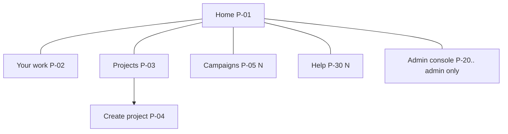
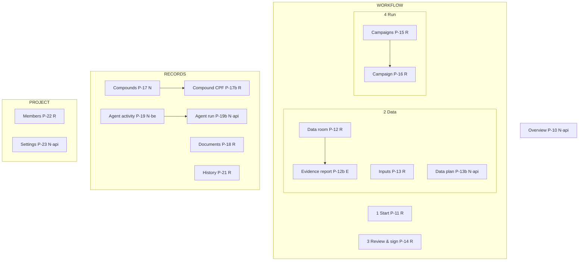

# Product Sitemap and Navigation (Phase 3, Gate 2)

Status labels: **[E]** existing page, kept as is · **[R]** existing, redesigned or moved · **[N]** new page ·
**[N·api]** new page on existing API routes · **[N·be]** new page that needs a backend change ·
**[Q]** waits on an owner question (Gate 2 summary). Page ids (P-xx) refer to [`PAGE_INVENTORY.md`](PAGE_INVENTORY.md).

## 1. The shell (every page)

```
┌──────────────────────────────────────────────────────────────────────────────────────────────────────┐
│ [logo] Modeler One │ Go to project… ▾ │                         Your work (7) │ Help │ ● API │ Ayush ▾ │  top bar, 48 px, white
├───────────────────┬──────────────────────────────────────────────────────────────────────────────────┤
│ ← All projects    │ Projects / Exampleamide PBPK / Data / Inputs                    breadcrumbs        │
│ Exampleamide PBPK │ ┌────────────────────────────────────────────────────────────────────────────────┐ │
│ Exampleamide ·med │ │ Inputs  [3 to decide]                        [Secondary]  [Primary action]    │ │ page header
│ ───────────────── │ │ What goes into the model, and its signed confirmation.             Info ⓘ    │ │
│ Overview          │ └────────────────────────────────────────────────────────────────────────────────┘ │
│ WORKFLOW          │ ┌ flash bar: success / error / warning, dismissible ───────────────────────────┐   │
│ ✓ 1 Start         │ └──────────────────────────────────────────────────────────────────────────────┘   │
│ ● 2 Data          │  Tabs or in-page nav  │  Content: tables, cards, forms                │  Help panel │
│     Data room     │                       │                                               │  (Info ⓘ,   │
│     Inputs     ◀  │                       │                                               │  optional)  │
│ ○ 3 Review & sign │                       ├───────────────────────────────────────────────┤             │
│ ○ 4 Run           │                       │ Split panel: the selected row's detail / source│             │
│ RECORDS           │                       └───────────────────────────────────────────────┘             │
│   Compounds       │                                                                                    │
│   Documents       │                                                                                    │
│   Agent activity  │                                                                                    │
│   History         │                                                                                    │
│ PROJECT           │                                                                                    │
│   Members         │                                                                                    │
│   Settings        │                                                                                    │
└───────────────────┴──────────────────────────────────────────────────────────────────────────────────┘
```

| Element | Behaviour | Replaces |
|---|---|---|
| Top bar | White, 48 px, bottom hairline. Logo → Home. "Go to project…" combobox (type-ahead over `GET /projects`). Right: **Your work** with its count, **Help**, API status dot (click re-checks), user menu (name, company, roles, Sign out). Development sign-in says so in the user menu. | The icon rail's foot |
| Side navigation | **Fixed, 240 px, always open** on desktop; collapses to a menu button below 1024 px; never opens on hover. Context-dependent: portfolio, project, or admin (§2–§4). Steps show a status icon from `GET /projects/{id}/steps`: ✓ done · ● needs you · ◐ in progress · ○ not started. Active item: accent text on accent tint with a 3 px accent bar. | Hover rail + step bar |
| Breadcrumbs | Every page below Home. | — |
| Page header | Title, one-line description, a status badge, at most one primary action (accent) and secondary actions; "Info" opens the help panel. ~88 px. | The 300–420 px hero |
| Flash bar | Results of actions and page-level problems (API unreachable, refused write) stacked under the header. | Toasts and inline banners |
| Help panel | Right panel with the plain-words explanation of the page (MS-01 terms, Part 11 meaning of a signature, what a status word means). Long explanatory paragraphs move here. | Paragraphs inside cards |
| Split panel | Bottom or right panel showing the selected row's detail: a value's source page or sheet line, a document, an agent run step. | Data room source drawer, document dialog |
| Escalation notice | An open escalation **on a project the person may sign** shows a flash bar on that project's pages and an item in Your work; the dialog opens from there. | The global pop-up on every page (see R-S02) |
| Read-only state | From `GET /members` (`owner_name`, `you_change_it`, no backend change). When the person is not the project's owner: a flash "Shared with you to read. Only the owner, NAME, changes it." and no edit controls (a reviewer still sees Sign where it may sign). | Buttons that answer NOT_OWNER |

## 2. Portfolio context (no project open)



| Nav item | Route | Page | Status |
|---|---|---|---|
| Home | `/` | P-01 Home: your work summary, portfolio status, risk across programs | [R] |
| Your work | `/work` | P-02 Your work: links to every decision, signature and to-confirm item, by project | [N·api], step state per project later [N·be] |
| Projects | `/projects` | P-03 Projects table (cards view kept as an option) with archive / restore | [R] (today part of `/`) |
| — (button "Create project") | `/projects/start` | P-04 Create project from a proposal | [R] |
| Campaigns | `/campaigns` | P-05 Campaigns across my projects | [N·api]: `GET /campaigns` filters by membership since 2026-11-23 (R-S01, fixed) |
| Help | `/help` | P-30 Help and documentation (from `docs/USING_THE_TOOL.md`) | [N] |
| PLATFORM → Admin console | `/admin` | P-20 | [E] admin only |

## 3. Project context (inside a project)



| Nav group | Item | Route | Page | Status | Notes |
|---|---|---|---|---|---|
| — | Overview | `/projects/{id}` | P-10 | [N·api] | Becomes the project home (today this URL is the Run page) |
| WORKFLOW | 1 Start | `/projects/{id}/start` | P-11 | [R] | The brief |
| WORKFLOW | 2 Data → Data room | `/projects/{id}/dataroom` | P-12 | [R] | What the client sent and whether it is right (G1-1) |
| | 2 Data → Data room → Evidence report | `/projects/{id}/dataroom/report` | P-12b | [E] | Print layout, light |
| | 2 Data → Inputs | `/projects/{id}/inputs` | P-13 | [R] | What goes into the model (G1-1) |
| | 2 Data → Data plan | `/projects/{id}/data-plan` | P-13b | [N·api] | Read-mostly: each requirement, who provides it, its status, a link to the card where it is settled (owner, Q1) |
| WORKFLOW | 3 Review & sign | `/projects/{id}/plan` | P-14 | [R] | MAP; read-only view for viewers through `plan:view` (R-S03) |
| WORKFLOW | 4 Run → Campaigns | `/projects/{id}/campaigns` | P-15 | [R] | Today's Run page content, without the duplicates |
| | 4 Run → Campaign | `/campaigns/{cid}` (kept) | P-16 | [R] | Tabs: Stages · Fit · Rounds · Feedback · Package; breadcrumb under its project |
| RECORDS | Compounds | `/projects/{id}/compounds` | P-17 | [N] | List; one row per compound with completeness |
| | Compound | `/projects/{id}/compounds/{c}` | P-17b | [R] | CPF table |
| RECORDS | Documents | `/projects/{id}/library` | P-18 | [R] | Renamed from "Project Document Library" |
| RECORDS | Agent activity | `/projects/{id}/agent-activity` | P-19 | [N·be] | Needs a list route (R-N05) |
| | Agent run | `/projects/{id}/agent-activity/{run}` | P-19b | [N·api] | `GET /agent-runs/{run_id}` |
| RECORDS | History | `/projects/{id}/history` | P-21 | [R] | Tabs: Audit trail · Signatures · Versions · Out of date |
| PROJECT | Members | `/projects/{id}/members` | P-22 | [R] | Moved out of the Run page |
| PROJECT | Settings | `/projects/{id}/settings` | P-23 | [N·api] | Owner, archive / restore with a reason; blinding state shown read-only (it is set on Review & sign) |

Placement changes inside the project (each keeps the capability, rule 6 "nothing becomes impossible"):

| Capability | Today | Proposed | Why |
|---|---|---|---|
| Model system (parent, metabolites, enantiomers) | Run page `SystemPanel` | Inputs → Compound area | It is a model input |
| Questions of interest table | Run page | Overview | Project-level facts |
| Observed studies (first 10) | Run page | Removed (Inputs → Clinical studies holds the list) | Duplicate of Inputs |
| Members | Run page `MembersPanel` | Members page | A record of the project, not a step |
| Archive / restore | Projects list only | Projects list **and** Settings | Reachable from inside the project |
| Add data (any step) | Sidebar button | Header action on Data room ("Upload a delivery") and Documents ("Add documents"); Overview keeps "Add data" | Two upload paths remain until the "official send" decision (G1-1 open) |
| Escalation decision | Global pop-up on any page | Flash bar on the project's pages + Your work item; dialog opens there | Only people who may sign see it (R-S01, R-S02) |

## 4. Admin console context (`modeler-admin` only)

| Nav item | Route | Page | Status |
|---|---|---|---|
| Overview | `/admin` | P-20 | [R] |
| Companies | `/admin/companies` | P-24 (list) | [R] split out of the overview |
| — company | `/admin/companies/{t}` | P-24b | [E] |
| People | `/admin/people` | P-25 | [E] |
| Usage and cost | `/admin/usage` | P-26 | [E] |
| Agents and models | `/admin/models` | P-27 | [E] |
| Keys | `/admin/keys` | P-28 | [E] |
| Limits | `/admin/limits` | P-29 | [E] |
| Intake pipeline | `/admin/pipeline` | P-31 | [E] |
| System status | `/admin/system` | P-32 | [N·api] `/health`, overview's platform block, pipeline; engine check later [N·be] |
| Platform audit log | `/admin/audit` | P-33 | FUTURE [N·be]: the owner's chain has no read route |
| Routines | `/admin/routines` | — | FUTURE (admin plan G) |

## 5. Who sees what

| Area | Viewer | Curator (owner) | Curator (shared) | Reviewer (shared) | QA | Admin |
|---|---|---|---|---|---|---|
| Home, Your work, Projects, Campaigns | ✓ own projects | ✓ | ✓ | ✓ | ✓ (proposed: all company projects, R-S05) | ✓ + Platform |
| Create project | — | ✓ | ✓ | ✓ | — | ✓ |
| Project pages | read | read + write | read | read + **sign** (MAP, escalations, records) | read (proposed) | as a member |
| Admin console | — | — | — | — | — | ✓ |

## 6. Old URL → new URL

| Today | Proposed | Handling |
|---|---|---|
| `/` (dashboard with project cards) | `/` Home + `/projects` | Home keeps a projects summary |
| `/projects/{id}` (Run page) | `/projects/{id}` Overview; Run → `/projects/{id}/campaigns` | Old bookmarks land on Overview, one click to Campaigns |
| `/review` (redirect) | `/work` | Redirect target changes to Your work |
| everything else | unchanged | — |

## 7. Where each screenless API operation lands

All 22 (Gate 1 said 21; `POST /campaigns/{id}/deviations` was wrongly counted as used). Detail and evidence in
[`REMEDIATION_PLAN.md`](REMEDIATION_PLAN.md) §2.

| Operation | Lands in | Verdict |
|---|---|---|
| `GET /projects/{id}/plan:view` | P-14 Review & sign, read-only | **Expose** (fixes viewer 403) |
| `POST /plan/placements/{s}:unlock` | P-14, "Back to the MS-01 default" on a moved study | **Expose** |
| `POST /projects/{id}/impact` | P-11, P-13, P-14: "What this changes" before saving a signed or confirmed input | **Expose** |
| `GET /projects/{id}/agent-runs/{run}` | P-19b Agent run | **Expose** (+ list route) |
| `GET /campaigns/{id}/package` | P-16 Package tab (hashes, files, PK-Sim projects, report issues) | **Expose** |
| `GET /health` | P-32 System status; top bar dot | **Expose** |
| `GET /requirements` | P-13b Data plan (read-mostly) | **Expose** (Q1: yes) |
| `PUT /requirements/{r}`, `POST requirements:derive` | none: edits stay on the cards; derive already runs on every brief save | **Keep API-only** |
| `GET /templates`, `GET /templates/{id}` | none (owner, Q2) | **Retire, after** the campaign-monitor e2e and the showcase script stop using them; the importer stays |
| `POST /model-versions/preview`, `POST /m15/validate` | none (API-only) | **Keep**; authentication added 2026-11-23 (R-S04, fixed) |
| `POST /runs`, `GET /runs/{id}/results` | P-16 Runs tab once the distributed deployment exists | **Keep for Temporal** |
| `POST escalation:decide`, `POST /campaigns/{id}/deviations` | none | **Rewrite to token step-up before any Temporal deployment** (R-S06) |
| `GET /escalations/decision-options` | none | **Retire or extend with the rewrite** (R-S06) |
| `POST /campaigns/{id}/feedback:decide` | none | **Retire** (alias of `escalation:resolve` at S5) |
| `POST /questions/{q}/map:generate` | none | **Retire** (stateless; the plan canvas persists the MAP) |
| `POST /client-review:edit` | none | **Verify, then retire** |
| `GET /proposals` | none | **Retire with its dead chain** |
